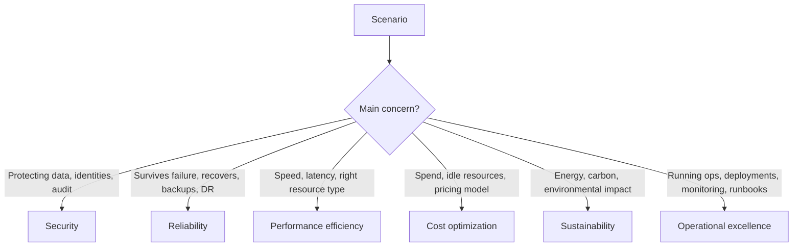

---
tags:
  - clf-c02
  - domain-1
  - task-statement
domain: 1
task: "1.2"
domain_weight: "24%"
status: not-started
aliases:
  - Task 1.2
---
# 1.2 Identify design principles of the AWS Cloud

> [!abstract] Exam guide objective (verbatim from the CLF-C02 exam guide)
> **Knowledge of:**
> - AWS Well-Architected Framework
>
> **Skills in:**
> - Understanding the pillars of the Well-Architected Framework (for example, operational excellence, security, reliability, performance efficiency, cost optimization, sustainability)
> - Identifying differences between the pillars of the Well-Architected Framework

## Big picture

The AWS Well-Architected Framework is AWS's set of best practices for building and running workloads in the cloud, organized into six pillars. The exam does not ask you to design architectures; it asks you to **name the pillar** a scenario or design principle belongs to, and to tell apart look-alike pillars (reliability vs performance efficiency, cost optimization vs sustainability, operational excellence vs reliability). You also need to know that the **AWS Well-Architected Tool** is the free console service that reviews a workload against the framework. Memorize each pillar's one-line definition from the reference guide and two or three of its design principles.

## Key concepts

### What the framework is

The **AWS Well-Architected Framework** describes key concepts, design principles, and best practices for designing and running workloads in the cloud. A **workload** is a set of components that together deliver business value (for example, an e-commerce site). The framework is organized into **six pillars**; for each pillar it gives design principles and a set of questions you answer to find risks. It helps you understand the pros and cons of decisions, and it is not a certification or a compliance standard.

Mnemonic for the six pillars: ==**"CROPS + S"**== or **"SPORCS"**: **S**ecurity, **P**erformance efficiency, **O**perational excellence, **R**eliability, **C**ost optimization, **S**ustainability. Sustainability was added in December 2021 as the sixth pillar.

### The six pillars (reference guide definitions)

| Pillar | Reference guide definition (exam wording) | It answers the question… |
| --- | --- | --- |
| **Operational excellence** | Support development and run workloads effectively, gain insights into workload operations, and continuously improve supporting processes and procedures to deliver business value. | How do we **run, monitor, and improve** operations? |
| **Security** | Protect data, systems, and assets by using cloud technologies to improve security. | How do we **protect** data and systems? |
| **Reliability** | The ability of a workload to perform its intended function correctly and consistently when expected throughout its lifecycle. | Does it **keep working and recover** from failure? |
| **Performance efficiency** | Use computing resources efficiently to meet system requirements and to maintain efficiency as demand changes and technologies evolve. | Are we using the **right resource types and sizes** for speed? |
| **Cost optimization** | The ability to run systems to deliver business value at the lowest price point. | Are we **avoiding unnecessary spend**? |
| **Sustainability** | Focuses on environmental impacts, especially energy consumption and efficiency, to inform direct actions to reduce resource usage. | Are we **minimizing environmental impact**? |

### General design principles

The framework lists six general design principles that apply across all pillars:

1. **Stop guessing your capacity needs** (scale in and out automatically)
2. **Test systems at production scale** (create a full-size test environment on demand, then delete it)
3. **Automate with architectural experimentation in mind** (automation makes it cheap to create, replicate, and revert)
4. **Consider evolutionary architectures** (designs can change over time rather than being fixed once)
5. **Drive architectures using data** (make fact-based decisions from workload data)
6. **Improve through game days** (regularly simulate events in production to practice)

### Design principles by pillar

**Operational excellence**
- Current wording: Organize teams around business outcomes; Implement observability for actionable insights; **Safely automate where possible**; **Make frequent, small, reversible changes**; Refine operations procedures frequently; **Anticipate failure**; **Learn from all operational events and metrics**; Use managed services.
- Older wording you may still see in exam questions: ==**Perform operations as code**==, and "Learn from all operational failures".
- Cue: runbooks, observability, deployments, small reversible changes, post-incident learning, operations as code.

**Security**
- ==**Implement a strong identity foundation**== (least privilege, separation of duties, centralized identity, no long-term static credentials)
- **Maintain traceability** (older wording: "Enable traceability"): monitor, alert, and audit actions in real time
- **Apply security at all layers** (defense in depth)
- **Automate security best practices**
- **Protect data in transit and at rest** (classification, encryption, tokenization, access control)
- **Keep people away from data** (reduce direct, manual access)
- **Prepare for security events** (incident response simulations)

**Reliability**
- ==**Automatically recover from failure**==
- **Test recovery procedures**
- **Scale horizontally to increase aggregate workload availability** (many small resources instead of one big one, so no single point of failure)
- **Stop guessing capacity**
- **Manage change through automation**
- Cue: multi-AZ, backups, disaster recovery, recovering from failure, service quotas, handling resource saturation.

**Performance efficiency**
- **Democratize advanced technologies** (consume complex technology such as ML or NoSQL as a managed service)
- ==**Go global in minutes**==
- **Use serverless architectures**
- **Experiment more often** (compare instance types, storage, configurations)
- **Consider mechanical sympathy** (pick the technology that fits how the workload uses data)
- Cue: choosing the right instance type, storage, or database for speed; lower latency; caching; selecting resource types as demand changes.

**Cost optimization**
- **Implement cloud financial management**
- ==**Adopt a consumption model**== (pay only for what you use; for example, stopping dev/test resources outside the 40 working hours of a 168-hour week saves about 75%)
- **Measure overall efficiency**
- **Stop spending money on undifferentiated heavy lifting**
- **Analyze and attribute expenditure** (tags, cost allocation, ROI per workload owner)
- Cue: rightsizing, purchasing options (Reserved Instances, Savings Plans, Spot), turning off idle resources, budgets, cost allocation.

**Sustainability**
- **Understand your impact**
- **Establish sustainability goals**
- ==**Maximize utilization**== (two hosts at 30% are less efficient than one at 60%)
- **Anticipate and adopt new, more efficient hardware and software offerings** (for example, AWS Graviton processors)
- **Use managed services** (shared infrastructure runs at higher utilization)
- **Reduce the downstream impact of your cloud workloads**
- Cue: energy, carbon footprint, environmental impact, reducing resources per transaction.

### How to tell the pillars apart in a scenario

| Look-alike pair | How to decide |
| --- | --- |
| Reliability vs performance efficiency | Reliability is **does it work and recover** (failure, availability, DR). Performance efficiency is **how fast and how efficiently** it serves (latency, instance family, caching). Auto scaling to avoid **failure from saturation** is reliability; choosing **compute-optimized instances** for speed is performance efficiency. |
| Cost optimization vs sustainability | Both reduce waste. If the goal is **money**, cost optimization. If the goal is **energy, carbon, or environmental impact**, sustainability. Rightsizing serves both; read the stated motive. |
| Operational excellence vs reliability | Operational excellence is about **how people and processes run the workload** (runbooks, deployments, observability, learning from events). Reliability is about **the workload's ability to recover**. "Make small, reversible changes" and "operations as code" are operational excellence; "automatically recover from failure" is reliability. |
| Security vs operational excellence | Traceability, identity, encryption, and incident response for **security events** are security. General monitoring and incident handling for **operational events** are operational excellence. |
| Performance efficiency vs cost optimization | "Use serverless" and "go global in minutes" are performance efficiency principles; "adopt a consumption model" and "stop spending money on undifferentiated heavy lifting" are cost optimization. |

### The AWS Well-Architected Tool

The **AWS Well-Architected Tool** (reference guide: "provides recommendations to improve workloads based on best practices") is a service in the AWS Management Console, available **at no charge**. You define a workload, answer a set of questions for each pillar, and the tool:

- Identifies **high-risk and medium-risk issues** compared with the framework's best practices.
- Produces an **improvement plan** with recommendations and links to guidance.
- Lets you save **milestones** to track progress over time.
- Supports **lenses**, which extend the framework for specific domains or technologies (for example, the Serverless Lens or SaaS Lens), plus custom lenses you define.

It is a self-service review tool. It does not change your resources, scan your account for vulnerabilities, or certify compliance.

## Services to know

| Service | One-line purpose | Signal phrase in a question |
| --- | --- | --- |
| [[Services - Management and Governance#AWS Well-Architected Tool\|AWS Well-Architected Tool]] | Free console tool that reviews a workload against the six pillars and gives an improvement plan | "Review our architecture against AWS best practices", "identify high-risk issues in a workload" |
| [[Services - Management and Governance#AWS Trusted Advisor\|AWS Trusted Advisor]] | Inspects your account and recommends improvements (cost, performance, security, fault tolerance, service quotas) | "Automated checks of the AWS account", "idle resources", "open security groups" |
| [[Services - Management and Governance#AWS CloudFormation\|AWS CloudFormation]] | Infrastructure as code; supports operations as code and managing change through automation | "Repeatable, automated deployments" |
| [[Services - Management and Governance#Amazon CloudWatch\|Amazon CloudWatch]] | Metrics, logs, alarms: observability for operational excellence and reliability | "Monitor and alarm on metrics" |
| [[Services - Management and Governance#AWS CloudTrail\|AWS CloudTrail]] | Records API activity: traceability for the security pillar | "Who did what, when" |

## Exam traps and commonly confused

> [!warning] Well-Architected Tool vs Trusted Advisor
> The **Well-Architected Tool** is a questionnaire-driven review of a **workload's design** against the six pillars; you answer the questions. **Trusted Advisor** runs **automated checks against resources in your account** (for example underutilized instances, open ports, service quotas). "Answer questions about our workload" means Well-Architected Tool; "automatically inspect our account" means Trusted Advisor.

> [!warning] Well-Architected Framework vs AWS CAF
> The Well-Architected Framework guides **how to build and run a workload** (technical, six pillars). The AWS Cloud Adoption Framework guides **an organization's cloud transformation** (six perspectives: Business, People, Governance, Platform, Security, Operations). Security and Operations appear in both lists; check whether the question is about a workload's architecture or an organization's adoption program. See [[1.3 Migration Strategies and AWS CAF]].

> [!warning] Sustainability is a pillar, "scalability" is not
> Distractors often list "scalability", "elasticity", "availability", or "agility" as pillars. The six pillars are exactly: operational excellence, security, reliability, performance efficiency, cost optimization, sustainability.

> [!warning] "Go global in minutes" appears twice
> It is one of the six advantages of cloud computing ([[1.1 Benefits of the AWS Cloud]]) and also a **performance efficiency** design principle. If the question asks which pillar, answer performance efficiency.

> [!warning] "Stop guessing capacity" appears three times
> Six advantages of cloud computing, general design principle, and a **reliability** design principle. If asked for a pillar, answer reliability.

## Quick self-check

> [!question]- Which pillar includes the design principle "automatically recover from failure"?
> Reliability.

> [!question]- Which pillar includes "perform operations as code" and "make frequent, small, reversible changes"?
> Operational excellence.

> [!question]- A company wants to choose the best instance family to reduce latency of its application. Which pillar is this?
> Performance efficiency.

> [!question]- A company wants to reduce the energy consumed by its workloads. Which pillar is this?
> Sustainability.

> [!question]- "Implement a strong identity foundation" belongs to which pillar?
> Security.

> [!question]- "Adopt a consumption model" and "analyze and attribute expenditure" belong to which pillar?
> Cost optimization.

> [!question]- Which AWS service lets you review a workload against Well-Architected best practices and produces an improvement plan, at no charge?
> AWS Well-Architected Tool.

> [!question]- Which pillar includes "democratize advanced technologies" and "use serverless architectures"?
> Performance efficiency.

> [!question]- Name the six pillars.
> Operational excellence, security, reliability, performance efficiency, cost optimization, sustainability.

> [!question]- Which sustainability design principle is illustrated by "one host at 60% utilization is better than two at 30%"?
> Maximize utilization.

## AWS references

- [AWS Well-Architected](https://aws.amazon.com/architecture/well-architected/): landing page for the framework, lenses, and tool.
- [AWS Well-Architected Framework whitepaper](https://docs.aws.amazon.com/wellarchitected/2025-02-25/framework/welcome.html): the framework text (2025-02-25 version).
- [General design principles](https://docs.aws.amazon.com/wellarchitected/2025-02-25/framework/general-design-principles.html): the six cross-pillar principles.
- [The pillars of the framework](https://docs.aws.amazon.com/wellarchitected/2025-02-25/framework/the-pillars-of-the-framework.html): per-pillar summaries and design principles.
- [AWS Well-Architected Tool User Guide](https://docs.aws.amazon.com/wellarchitected/latest/userguide/intro.html): what the tool does.
- [AWS Well-Architected Tool product page](https://aws.amazon.com/well-architected-tool/): features and pricing (no charge).

---
Up: [[Domain 1 Overview]] · Cards: [[Flashcards - Domain 1]] · Practice: [[Practice - Domain 1]] · Home: [[00 - Start Here]]
