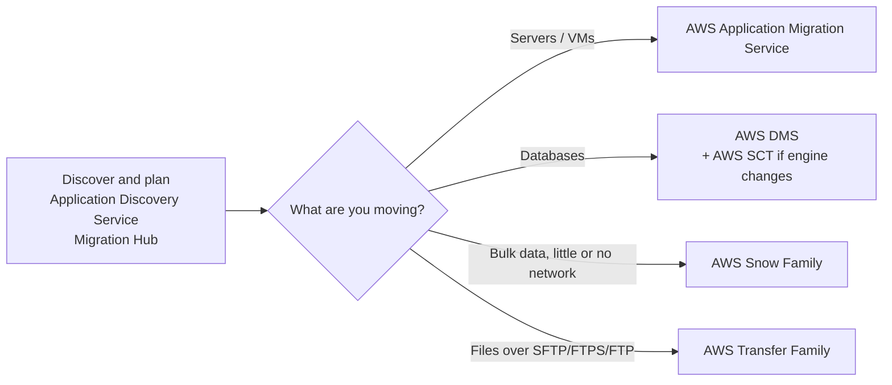

---
tags:
  - clf-c02
  - domain-1
  - task-statement
domain: 1
task: "1.3"
domain_weight: "24%"
status: not-started
aliases:
  - Task 1.3
---
# 1.3 Understand the benefits of and strategies for migration to the AWS Cloud

> [!abstract] Exam guide objective (verbatim from the CLF-C02 exam guide)
> **Knowledge of:**
> - Cloud adoption strategies
> - Resources to support the cloud migration journey
>
> **Skills in:**
> - Understanding the benefits of the AWS Cloud Adoption Framework (AWS CAF) (for example, reduced business risk; improved environmental, social, and governance [ESG]performance; increased revenue; increased operational efficiency)
> - Identifying appropriate migration strategies (for example, database replication, use of AWS Snowball)

## Big picture

This objective covers how an organization gets to AWS. Three things are tested. First, the **AWS Cloud Adoption Framework (AWS CAF)**: its six perspectives, who owns each, its four business outcomes, and its four transformation phases. Second, the **7 Rs** migration strategies: given a description of what happens to an application, name the strategy. Third, the **migration tools**: which service moves servers, which moves databases, which moves bulk data offline, and which tracks or plans a migration. Questions are usually "which perspective…", "which strategy…", or "which service…" with plausible look-alike options.

## Key concepts

### Cloud adoption strategies at a glance

An organization's move to the cloud has two layers. The **adoption** layer is organizational: getting leadership, people, governance, and operations ready (AWS CAF). The **migration** layer is per application: deciding what to do with each workload (the 7 Rs) and moving it with the right tools. AWS also offers help programs and people: AWS Professional Services, AWS Partners, AWS Prescriptive Guidance, and the AWS Migration Acceleration Program (MAP), which provides methodology, tools, and funding for larger migrations.

### AWS Cloud Adoption Framework (AWS CAF)

The **AWS CAF** uses AWS experience and best practices to help organizations digitally transform and accelerate business outcomes through innovative use of AWS. It helps you identify and prioritize transformation opportunities, evaluate and improve cloud readiness, and iteratively evolve a transformation roadmap.

#### Business outcomes (the CAF benefits named in the exam guide)

| Outcome | AWS description |
| --- | --- |
| ==**Reduced business risk**== | Lower your risk profile through improved reliability, increased performance, and enhanced security. |
| ==**Improved environmental, social, and governance (ESG) performance**== | Use insights to improve sustainability and corporate transparency. |
| ==**Increased revenue**== | Create new products and services, reach new customers, and enter new market segments. |
| ==**Increased operational efficiency**== | Reduce operating costs, increase productivity, and improve employee and customer experience. |

Mnemonic: **"RERO"**: Risk down, ESG up, Revenue up, Operational efficiency up.

#### The six perspectives

A **perspective** is a group of related **capabilities** (organizational abilities to use processes and resources to achieve an outcome) owned by a functionally related set of stakeholders. Business, People, and Governance are the **business-side** perspectives; Platform, Security, and Operations are the **technical** perspectives.

| Perspective | Focus | Common stakeholders (owners) | Capabilities |
| --- | --- | --- | --- |
| **Business** | Cloud investments accelerate digital transformation ambitions and business outcomes | CEO, CFO, COO, CIO, CTO | Strategy management, portfolio management, innovation management, product management, strategic partnership, data monetization, business insights, data science |
| **People** | Bridge between technology and business; culture, organizational structure, leadership, workforce | CIO, COO, CTO, cloud director, cross-functional and enterprise-wide leaders | Culture evolution, transformational leadership, ==cloud fluency==, ==workforce transformation==, change acceleration, organization design, organizational alignment |
| **Governance** | Orchestrate cloud initiatives while maximizing benefits and minimizing transformation risk | Chief transformation officer, CIO, CTO, CFO, chief data officer (CDO), chief risk officer (CRO) | Program and project management, benefits management, risk management, ==cloud financial management==, application portfolio management, data governance, data curation |
| **Platform** | Build an enterprise-grade, scalable, hybrid cloud platform; modernize workloads; implement cloud-native solutions | CTO, technology leaders, architects, engineers | Platform architecture, data architecture, platform engineering, data engineering, provisioning and orchestration, modern application development, continuous integration and continuous delivery (CI/CD) |
| **Security** | Confidentiality, integrity, and availability of data and cloud workloads | CISO, chief compliance officer (CCO), internal audit leaders, security architects and engineers | Security governance, security assurance, identity and access management, threat detection, vulnerability management, infrastructure protection, data protection, application security, incident response |
| **Operations** | Cloud services are delivered at a level that meets business needs | Infrastructure and operations leaders, site reliability engineers, IT service managers | Observability, event management (AIOps), incident and problem management, change and release management, performance and capacity management, configuration management, patch management, availability and continuity management, application management |

Mnemonic for the order: ==**"Big People Govern; Platforms Secure Operations"**== (Business, People, Governance | Platform, Security, Operations).

#### Transformation domains

CAF describes four **transformation domains** where value is created: **Technology** (migrate and modernize), **Process** (digitize, automate, optimize operations), **Organization** (reimagine the operating model around customers and products), and **Product** (new value propositions and revenue models). Business outcomes come from transforming all four together.

#### Transformation phases

The cloud transformation journey runs through four iterative, incremental phases:

| Phase | Focus |
| --- | --- |
| ==**Envision**== | Demonstrate how cloud will accelerate business outcomes: identify and prioritize transformation opportunities across the four domains, tied to stakeholders and measurable outcomes. |
| ==**Align**== | Identify capability gaps across the six perspectives, cross-organizational dependencies, and stakeholder concerns; create strategies to improve cloud readiness. |
| ==**Launch**== | Deliver pilot initiatives in production and demonstrate incremental business value; learn from pilots before scaling. |
| ==**Scale**== | Expand production pilots and business value to the desired scale, and make sure benefits are realized and sustained. |

Mnemonic: **"E-A-L-S"**, "Every Adopter Launches, then Scales".

### The 7 Rs migration strategies

A **migration strategy** is the approach used to move one workload into AWS. AWS Prescriptive Guidance lists seven. See [[Migration Strategies (7 Rs)]] for the one-screen version.

| Strategy | Also called | What happens | Typical example |
| --- | --- | --- | --- |
| **Retire** | Decommission | Shut down applications that are no longer useful. | An app nobody has used in 90 days |
| **Retain** | Revisit | Keep the application in the source environment for now. | Recently upgraded system, data residency rules, mainframe needing more analysis |
| **Rehost** | ==Lift and shift== | Move the application to AWS **without changes**. | On-premises VMs to Amazon EC2 with AWS Application Migration Service |
| **Relocate** | Hypervisor-level lift and shift | Move many servers to a **cloud version of the same platform** without buying hardware or changing apps; also moving resources to another VPC, Region, or account. | VMware workloads to VMware Cloud on AWS |
| **Repurchase** | ==Drop and shop== | Replace the application with a different product, typically **SaaS**. | Self-hosted CRM to a SaaS CRM |
| **Replatform** | ==Lift, tinker, and shift== (lift and reshape) | Move to the cloud with **some optimization**, without changing the core architecture. | Self-managed SQL Server to Amazon RDS for SQL Server |
| **Refactor / re-architect** | Re-architect | **Redesign** the application to use cloud-native features (serverless, microservices). Most complex and costly. | Monolith rewritten as microservices on Lambda and DynamoDB |

Rough ordering by how much the application changes (least to most): Retire and Retain (nothing moves), Relocate and Rehost (moves unchanged; AWS calls relocate the quickest way to migrate), Repurchase (swapped for a product), Replatform (some optimization), Refactor (redesigned; most complex and costly). For large migrations AWS recommends rehost, relocate, or replatform first and modernizing after the move.

### Migration tools and resources (Cloud Practitioner depth)

- **AWS Application Discovery Service**: collects usage and configuration data about on-premises servers and databases to help **plan** a migration. Agentless discovery runs through VMware vCenter; agent-based discovery installs an agent on each server and also captures running processes and network connections. Data is stored in the AWS Migration Hub home Region.
  - Current status: AWS Application Discovery Service is no longer open to new customers; AWS points new customers to AWS Transform.
- **AWS Migration Hub**: a central location to discover existing servers, plan migrations, and **track the status** of each application migration across tools.
  - Current status: AWS Migration Hub stopped accepting new customers on November 7, 2025; AWS recommends AWS Transform for new migration projects.
- **AWS Application Migration Service** (sometimes abbreviated AWS MGN): automated **lift-and-shift (rehost)** of physical, virtual, or cloud servers to AWS. It continuously replicates source servers, so cutover downtime is short.
- **AWS Database Migration Service (AWS DMS)**: migrates relational databases, data warehouses, NoSQL databases, and other data stores to AWS. The source database **stays fully operational** during migration, and DMS supports **ongoing replication** (change data capture) to keep source and target in sync. Supports homogeneous (Oracle to Oracle) and heterogeneous (Oracle to Aurora) migrations.
- **AWS Schema Conversion Tool (AWS SCT)**: converts a database **schema** from one engine to another; pair it with DMS for heterogeneous migrations.
- **AWS Snow Family**: physical, rugged devices AWS ships to you for **offline data transfer** and **edge computing** in locations with limited or no connectivity. You load data locally, ship the device back, and AWS imports it into Amazon S3.
  - **AWS Snowcone**: smallest, portable device for edge and small transfers.
  - **AWS Snowball Edge** (Storage Optimized and Compute Optimized): terabyte-scale devices for large transfers and local compute.
  - **AWS Snowmobile**: a 45-foot shipping container on a truck that moves up to **100 PB** (exabyte-scale migrations).
  - Rule of thumb: when moving the data over the network would take weeks or months, or bandwidth is limited or expensive, use Snow Family.
  - Current status: AWS Snowball Edge is no longer available to new customers, and AWS no longer offers any Snow Family devices for new customers to order (cutoff November 7, 2025). AWS suggests AWS DataSync for online transfers, AWS Data Transfer Terminal for physical transfers, and AWS Outposts for edge compute. The exam still tests Snow Family.
- **AWS Transfer Family**: managed SFTP, FTPS, and FTP endpoints for transferring files into and out of Amazon S3 or Amazon EFS.
- **AWS DataSync** (not on the in-scope list, but a common distractor): online data transfer between on-premises storage and AWS storage over the network.

### "Database replication" and "use of AWS Snowball" as strategies

The exam guide's two examples map to tools:
- **Database replication**: use **AWS DMS** with ongoing replication to keep a target database in AWS synchronized with the on-premises source, then cut over with minimal downtime.
- **Use of AWS Snowball**: when the dataset is too large or the network too slow, copy data to a Snowball Edge device and ship it to AWS.

### Resources to support the migration journey

- **AWS Prescriptive Guidance**: AWS-written strategies, guides, and patterns for migration and modernization.
- **AWS Professional Services** and **AWS Partner Network (APN)** consulting partners (system integrators): hands-on help with migrations.
- **AWS Migration Acceleration Program (MAP)**: methodology, training, tools, and investment for large migrations.
- **Migration Evaluator** (formerly TSO Logic): builds a data-driven business case and projected cost of running on AWS.
- **AWS Training and Certification / AWS Skill Builder**: builds cloud fluency (CAF People perspective).

## Services to know

| Service | One-line purpose | Signal phrase in a question |
| --- | --- | --- |
| [[Services - Migration and Transfer#AWS Application Discovery Service\|AWS Application Discovery Service]] | Collects on-premises server usage and configuration data to plan a migration | "Inventory on-premises servers", "discover dependencies before migrating" |
| [[Services - Migration and Transfer#AWS Migration Hub\|AWS Migration Hub]] | Central place to plan and track application migrations | "Track migration progress across tools" |
| [[Services - Migration and Transfer#AWS Application Migration Service\|AWS Application Migration Service]] | Automated lift-and-shift (rehost) of servers | "Rehost", "lift and shift servers with minimal downtime" |
| [[Services - Migration and Transfer#AWS Database Migration Service (AWS DMS)\|AWS DMS]] | Migrates databases with continuous replication; source stays online | "Migrate a database with minimal downtime", "database replication" |
| [[Services - Migration and Transfer#AWS Schema Conversion Tool (AWS SCT)\|AWS SCT]] | Converts database schema between engines | "Oracle to PostgreSQL", "heterogeneous migration" |
| [[Services - Migration and Transfer#AWS Snow Family\|AWS Snow Family]] | Physical devices for offline transfer and edge computing | "Petabytes", "limited bandwidth", "no network connectivity" |
| [[Services - Migration and Transfer#AWS Transfer Family\|AWS Transfer Family]] | Managed SFTP/FTPS/FTP into S3 or EFS | "Partners upload files over SFTP" |

## Exam traps and commonly confused

> [!warning] Rehost vs replatform vs refactor
> No changes = **rehost**. Small optimization without changing the core architecture (for example, moving the database to Amazon RDS or the app to Elastic Beanstalk) = **replatform**. Rewriting for cloud-native features = **refactor**. A move to a managed database service is the classic replatform example.

> [!warning] Repurchase vs replatform
> Repurchase replaces the application with **a different product** (often SaaS). Replatform keeps **your application** and changes the platform under it.

> [!warning] Retire vs retain
> Retire = turn it off for good. Retain = keep it where it is for now (maybe revisit later).

> [!warning] Application Migration Service vs DMS vs Snow Family
> Servers and VMs: Application Migration Service. Databases with the source still running: DMS. Huge volumes with poor connectivity: Snow Family. Changing database engine: add SCT.

> [!warning] Application Discovery Service vs Migration Hub
> Discovery Service **collects** data about on-premises servers. Migration Hub is the **dashboard** that tracks migrations (and shows discovered data).

> [!warning] CAF perspective traps
> Training staff and building cloud skills = **People** (cloud fluency, workforce transformation), not Operations. Cloud financial management and risk management = **Governance**, not Business. CI/CD and architecture = **Platform**. Monitoring and patching = **Operations**. Identity, threat detection, and data protection = **Security**. Strategy, portfolio, and innovation = **Business**.

> [!warning] CAF vs Well-Architected Framework
> CAF is for **organizational adoption** (perspectives, phases). Well-Architected is for **workload architecture** (pillars). "Perspective" signals CAF; "pillar" signals Well-Architected.

## Quick self-check

> [!question]- Which AWS CAF perspective includes cloud fluency and workforce transformation?
> People.

> [!question]- Which AWS CAF perspective includes cloud financial management, risk management, and benefits management?
> Governance.

> [!question]- Which CAF perspective's stakeholders include the CTO, architects, and engineers, and covers CI/CD and platform engineering?
> Platform.

> [!question]- Name the four AWS CAF transformation phases in order.
> Envision, Align, Launch, Scale.

> [!question]- Name the four business outcomes of AWS CAF from the exam guide.
> Reduced business risk; improved ESG performance; increased revenue; increased operational efficiency.

> [!question]- A company moves its self-managed MySQL database from on premises to Amazon RDS for MySQL without changing the application. Which migration strategy is this?
> Replatform.

> [!question]- A company replaces its on-premises email server with a SaaS email product. Which strategy is this?
> Repurchase.

> [!question]- Which service migrates a database to AWS while the source database stays operational and keeps them in sync?
> AWS Database Migration Service (AWS DMS).

> [!question]- A company must move 5 PB of data from a site with slow internet. Which service family fits best?
> AWS Snow Family (Snowball Edge devices).

> [!question]- Which service automates lift-and-shift migration of on-premises servers to Amazon EC2?
> AWS Application Migration Service.

## AWS references

- [AWS Cloud Adoption Framework](https://aws.amazon.com/cloud-adoption-framework/): landing page with the four business outcomes.
- [An Overview of the AWS CAF (whitepaper)](https://docs.aws.amazon.com/whitepapers/latest/overview-aws-cloud-adoption-framework/welcome.html): full CAF text.
- [CAF foundational capabilities](https://docs.aws.amazon.com/whitepapers/latest/overview-aws-cloud-adoption-framework/foundational-capabilities.html): the six perspectives and their stakeholders.
- [CAF cloud transformation journey](https://docs.aws.amazon.com/whitepapers/latest/overview-aws-cloud-adoption-framework/your-cloud-transformation-journey.html): Envision, Align, Launch, Scale.
- [About the migration strategies (AWS Prescriptive Guidance)](https://docs.aws.amazon.com/prescriptive-guidance/latest/large-migration-guide/migration-strategies.html): the 7 Rs with use cases.
- [AWS Cloud Migration](https://aws.amazon.com/cloud-migration/): AWS migration programs and tools overview.
- [What is AWS Application Migration Service?](https://docs.aws.amazon.com/mgn/latest/ug/what-is-application-migration-service.html): rehost tool.
- [What is AWS DMS?](https://docs.aws.amazon.com/dms/latest/userguide/Welcome.html): database migration and replication.
- [What is AWS Application Discovery Service?](https://docs.aws.amazon.com/application-discovery/latest/userguide/what-is-appdiscovery.html): discovery for migration planning.
- [AWS Migration Hub availability change](https://docs.aws.amazon.com/migrationhub/latest/ug/migrationhub-availability-change.html): current status notice.
- [AWS Snowball Edge availability change](https://docs.aws.amazon.com/snowball/latest/developer-guide/snowball-edge-availability-change.html): current status notice and alternatives.
- [Migration Evaluator](https://aws.amazon.com/migration-evaluator/): business case and cost projection for migration.

---
Up: [[Domain 1 Overview]] · Cards: [[Flashcards - Domain 1]] · Practice: [[Practice - Domain 1]] · Home: [[00 - Start Here]]
