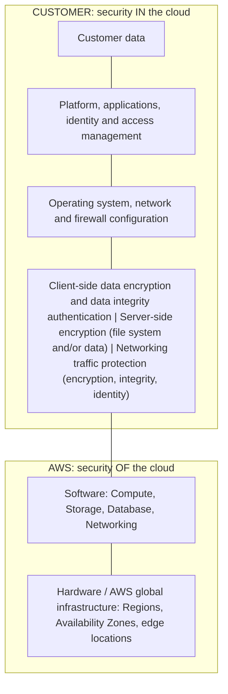

---
tags:
  - clf-c02
  - domain-2
  - task-statement
domain: 2
task: "2.1"
domain_weight: "30%"
status: not-started
aliases:
  - Task 2.1
---
# 2.1 Understand the AWS shared responsibility model

> [!abstract] Exam guide objective (verbatim from the CLF-C02 exam guide)
> **Knowledge of:**
> - AWS shared responsibility model
>
> **Skills in:**
> - Recognizing the components of the AWS shared responsibility model
> - Describing the customer’s responsibilities on AWS
> - Describing AWS responsibilities
> - Describing responsibilities that the customer and AWS share
> - Describing how AWS responsibilities and customer responsibilities can shift, depending on the service used (for example, Amazon RDS, AWS Lambda, Amazon EC2)

## Big picture

The shared responsibility model splits security work between AWS and the customer. ==AWS is responsible for security **of** the cloud (the hardware, software, networking, and facilities that run AWS services); the customer is responsible for security **in** the cloud (their data, identities, and how they configure the services they use).== The line moves depending on the service: the more AWS manages (EC2, then RDS, then Lambda or S3), the less the customer has to do, but the customer always owns their data and their IAM permissions. Exam questions give you a task ("patch the guest OS", "secure the data center", "encrypt client-side data") and ask who does it, or ask which responsibility changes when you move from EC2 to a managed service. Expect several questions; this is one of the most tested topics on the exam.

## Key concepts

### Security "of" the cloud vs security "in" the cloud

- **Security of the cloud (AWS):** protecting the global infrastructure that runs every AWS service: Regions, Availability Zones, edge locations, the physical data centers, the host hardware, the network, and the virtualization layer (hypervisor). Third-party auditors verify this through the AWS compliance programs.
- **Security in the cloud (customer):** everything the customer puts on or configures in AWS. What that includes depends on the service chosen, plus the sensitivity of the data, the organization's own requirements, and the laws that apply.

The AWS diagram, from bottom to top:

Mnemonic: AWS secures what you **cannot touch** (buildings, hardware, hypervisor). You secure what you **create or configure** (data, users, OS on EC2, firewall rules, encryption choices).

### The reference guide lists (memorize these)

These lists come word for word from the last page of the official CLF-C02 reference guide. AWS notes they are examples, not a complete list.

| AWS responsibility | Customer responsibility | Shared responsibility |
| --- | --- | --- |
| Global infrastructure | Client-side data integrity and encryption | Patches |
| Hosts | Manage guest OS | Configuration |
| Operation and virtualization of software | Set password policies | Training and awareness |
| Hardware maintenance | Configure firewalls and networks | |
| Physical and environmental controls | Encrypt client-side data | |
| Edge location management | Configure IAM roles | |
| Secure the EC2 hypervisor | Patch OS of EC2 instances | |
| Patch OS of RDS instances | Determine which services have access to DynamoDB tables | |
| Patch ELBs | | |
| Patch OS used by Lambda | | |
| Server-side encryption in Amazon S3 | | |

> [!note] "Server-side encryption in Amazon S3" is on the AWS list
> AWS performs the encryption work for S3 server-side encryption (and since January 2023 encrypts every new S3 object with SSE-S3 by default). The customer still chooses the encryption option and key type (for example SSE-KMS) and protects any data encrypted client-side. If a question asks who *performs* S3 server-side encryption, the answer is AWS; who *encrypts client-side data* is the customer.

### Inherited, shared, and customer-specific controls

AWS IT controls fall into three groups (from the AWS shared responsibility model page):

| Control type | Meaning | Example |
| --- | --- | --- |
| **Inherited controls** | Controls the customer fully inherits from AWS | Physical and environmental controls |
| **Shared controls** | Controls that apply to both the infrastructure layer and the customer layer, each party in its own context | Patch management, configuration management, awareness and training |
| **Customer-specific controls** | Controls that are solely the customer's responsibility | Service and communications protection or zone security (routing or zoning data within specific security environments) |

How each shared control splits:

- **Patch management:** AWS patches the infrastructure (hosts, hypervisor, managed service software); the customer patches their guest OS and applications.
- **Configuration management:** AWS configures its infrastructure devices; the customer configures their guest OS, databases, and applications.
- **Awareness and training:** AWS trains AWS employees; the customer trains their own employees.

### How responsibility shifts with the service

Rule: **the more managed the service, the more AWS takes on.** The customer never gives up responsibility for data, IAM, and access to that data.

- **Amazon EC2 (infrastructure as a service, IaaS):** AWS secures the physical host, network, and hypervisor. The customer manages the guest operating system (updates and security patches), any installed software, the security group (instance firewall) configuration, IAM roles, and data encryption.
- **Amazon RDS (managed database):** AWS also patches the database OS and database engine software, and runs backups on the schedule you set. The customer manages database user accounts and permissions, security group rules, encryption settings, network access (public or private), and the data.
- **AWS Lambda (serverless):** AWS manages the servers, OS, runtime language environment patching, and scaling. The customer manages their function code, the code's dependencies and libraries, the IAM execution role and permissions, and the data.
- **Abstracted services such as Amazon S3 and Amazon DynamoDB:** AWS runs the infrastructure, OS, and platform. The customer manages their data, asset classification, encryption options, and IAM permissions (for example "determine which services have access to DynamoDB tables").

| Task | Amazon EC2 (IaaS) | Amazon RDS (managed) | AWS Lambda (serverless) |
| --- | --- | --- | --- |
| Physical security, hardware, global network | AWS | AWS | AWS |
| Hypervisor / virtualization layer | AWS | AWS | AWS |
| Operating system patching | **Customer** (guest OS) | AWS | AWS |
| Database engine or runtime patching | Customer (if self-installed) | AWS | AWS (managed runtimes) |
| Application code | Customer | Customer (schema, queries) | Customer (function code) |
| Network firewall rules (security groups, NACLs) | Customer | Customer | Customer, only if the function connects to a VPC |
| IAM users, roles, and permissions | Customer | Customer (plus database users) | Customer (execution role) |
| Data and encryption choices | Customer | Customer | Customer |
| Scaling and capacity | Customer (or Auto Scaling) | Customer chooses size, AWS provisions | AWS (automatic) |

> [!tip] Abstraction ladder
> On-premises (you do everything) → EC2 (you start at the guest OS) → RDS (you start at the database settings) → Lambda / S3 / DynamoDB (you start at your code, data, and permissions).

### Why the model matters

- It defines what the customer must secure; a misconfigured S3 bucket or an unpatched EC2 OS is the customer's failure, not AWS's.
- Customers **inherit** AWS's audited infrastructure controls, so their own compliance work is smaller. AWS proves its side with third-party audit reports, available in [[Services - Security, Identity, and Compliance#AWS Artifact|AWS Artifact]] (see [[2.2 Security, Governance, and Compliance Concepts]]).

## Services to know

| Service | One-line purpose | Signal in a question |
| --- | --- | --- |
| [[Services - Compute#Amazon EC2\|Amazon EC2]] | Virtual servers (IaaS) | "Who patches the guest OS?" The customer |
| [[Services - Database#Amazon RDS\|Amazon RDS]] | Managed relational database | "Who patches the database OS / engine?" AWS |
| [[Services - Serverless#AWS Lambda\|AWS Lambda]] | Run code without servers | "Who manages the OS used by Lambda?" AWS; code and permissions are the customer's |
| [[Services - Storage#Amazon S3\|Amazon S3]] | Object storage | "Bucket policy, data classification, encryption choice" are customer; "server-side encryption in S3" is on the AWS list |
| [[Services - Database#Amazon DynamoDB\|Amazon DynamoDB]] | Managed NoSQL database | "Determine which services have access to DynamoDB tables" is customer |
| [[Services - Compute#Elastic Load Balancing (ELB)\|Elastic Load Balancing]] | Distributes traffic | "Patch ELBs" is AWS |
| [[Services - Security, Identity, and Compliance#AWS Identity and Access Management (IAM)\|AWS IAM]] | Users, roles, policies | IAM configuration is always the customer's |
| [[Services - Security, Identity, and Compliance#AWS Artifact\|AWS Artifact]] | Download AWS audit reports | "Evidence of AWS's side of the model" |

## Exam traps and commonly confused

> [!warning] Guest OS vs host OS
> On EC2 the **guest** operating system (the one inside your instance) is the customer's. The **host** OS and the **hypervisor** are AWS's. "Secure the EC2 hypervisor" is AWS.

> [!warning] Patching depends on the service
> "Patch OS of EC2 instances" = customer. "Patch OS of RDS instances", "patch ELBs", and "patch OS used by Lambda" = AWS. "Patches" in general = shared.

> [!warning] Data is always the customer's
> No service moves responsibility for customer data, its classification, or who can access it to AWS. Even for S3 and DynamoDB, the customer sets bucket policies and IAM permissions.

> [!warning] Client-side vs server-side encryption
> Client-side encryption (encrypting before upload) is the customer's. Server-side encryption in S3 is on the AWS list. Encryption *configuration* choices remain the customer's.

> [!warning] Security groups and NACLs are configured by the customer
> AWS provides the firewall features; "configure firewalls and networks" is a customer item. Do not pick AWS because the feature is built into AWS.

> [!warning] Training and awareness is shared, not AWS-only
> Each party trains its own people. Same for patches and configuration: each side handles its own layer.

| Statement | Owner |
| --- | --- |
| Decommissioning storage devices, data center guards | AWS (physical and environmental) |
| Edge location management | AWS |
| Set password policies, configure IAM roles | Customer |
| Manage guest OS, patch EC2 OS | Customer |
| Patch RDS OS, patch ELBs, patch Lambda OS | AWS |
| Patches, configuration, training and awareness | Shared |

## Quick self-check

> [!question]- Who is responsible for patching the operating system of an Amazon EC2 instance?
> The customer. The guest OS on EC2 is a customer responsibility.

> [!question]- Who patches the operating system of an Amazon RDS DB instance?
> AWS. RDS is a managed service, and "patch OS of RDS instances" is on the AWS list.

> [!question]- Name the three items the reference guide lists as shared responsibilities.
> Patches, configuration, and training and awareness.

> [!question]- What is an example of an inherited control?
> Physical and environmental controls. The customer fully inherits them from AWS.

> [!question]- Give an example of a customer-specific control.
> Service and communications protection or zone security, such as routing or zoning data within specific security environments.

> [!question]- When a workload moves from EC2 to Lambda, which responsibility moves from the customer to AWS?
> Operating system and runtime patching, server management, and scaling. The customer keeps function code, IAM permissions, and data.

> [!question]- Who determines which services can access a DynamoDB table?
> The customer, through IAM policies.

> [!question]- Who secures the EC2 hypervisor?
> AWS.

> [!question]- Is configuring security groups an AWS or customer task?
> Customer ("configure firewalls and networks").

## AWS references

- [AWS Shared Responsibility Model](https://aws.amazon.com/compliance/shared-responsibility-model/): the official page, with inherited, shared, and customer-specific controls.
- [Shared responsibility model (AWS Risk and Compliance whitepaper)](https://docs.aws.amazon.com/whitepapers/latest/aws-risk-and-compliance/shared-responsibility-model.html): how the model applies to compliance.
- [Introduction to AWS Security whitepaper](https://docs.aws.amazon.com/whitepapers/latest/introduction-aws-security/introduction-aws-security.html): overview of AWS security of the cloud.
- [Security in Amazon EC2](https://docs.aws.amazon.com/AWSEC2/latest/UserGuide/ec2-security.html): EC2's customer responsibilities.
- [Security in Amazon RDS](https://docs.aws.amazon.com/AmazonRDS/latest/UserGuide/UsingWithRDS.html): what changes with a managed database.
- [Security in AWS Lambda](https://docs.aws.amazon.com/lambda/latest/dg/lambda-security.html): Lambda's split of responsibilities.

---
Up: [[Domain 2 Overview]] · Cards: [[Flashcards - Domain 2]] · Practice: [[Practice - Domain 2]] · Home: [[00 - Start Here]]
