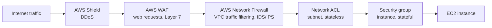

---
tags:
  - clf-c02
  - domain-2
  - task-statement
domain: 2
task: "2.4"
domain_weight: "30%"
status: not-started
aliases:
  - Task 2.4
---
# 2.4 Identify components and resources for security

> [!abstract] Exam guide objective (verbatim from the CLF-C02 exam guide)
> **Knowledge of:**
> - Security capabilities that AWS provides
> - Security-related documentation that AWS provides
>
> **Skills in:**
> - Describing AWS security features and services (for example, security groups, network ACLs, AWS WAF)
> - Understanding that third-party security products are available from AWS Marketplace
> - Identifying where AWS security information is available (for example, AWS Knowledge Center, AWS Security Center, AWS Security Blog)
> - Understanding the use of AWS services for identifying security issues (for example, AWS Trusted Advisor)

## Big picture

This objective covers the network and application protection features AWS provides (security groups, network ACLs, AWS WAF, AWS Shield, AWS Firewall Manager, AWS Network Firewall), where to buy third-party security tools (AWS Marketplace), where to read AWS security guidance (Knowledge Center, Security Center, Security Blog), and which service flags security problems for you (Trusted Advisor). The highest-yield item is the security group vs network ACL comparison: stateful vs stateless, allow-only vs allow and deny, instance level vs subnet level. The second is picking the right protection for an attack type: DDoS = Shield, SQL injection or cross-site scripting = WAF, many accounts = Firewall Manager, VPC-wide intrusion prevention = Network Firewall.

## Key concepts

### Layers of defense

AWS encourages **defense in depth**: apply security at every layer. From the outside in: edge (CloudFront, Shield, WAF) → VPC (Network Firewall, network ACLs on subnets) → instance (security groups) → OS and application (patching, Inspector) → data (encryption, IAM).

### Security groups vs network ACLs

- **Security group:** a virtual firewall for an instance (more precisely, its elastic network interface). Controls inbound and outbound traffic.
- **Network access control list (network ACL, NACL):** an optional firewall for a subnet. Controls traffic entering and leaving the subnet.
- **Stateful:** the firewall remembers a connection, so return traffic is automatically allowed. **Stateless:** each packet is evaluated alone, so return traffic needs its own rule.

| | Security group | Network ACL |
| --- | --- | --- |
| Level | ==Instance (network interface)== | ==Subnet== |
| State | ==Stateful== (return traffic allowed automatically) | ==Stateless== (return traffic must be explicitly allowed) |
| Rules | ==Allow rules only== | ==Allow and deny rules== |
| Evaluation | All rules evaluated together | Rules evaluated in number order, lowest first; first match wins |
| Default (new custom one) | Denies all inbound, allows all outbound | Custom NACL denies all inbound and outbound until rules are added |
| Default VPC behavior | Default security group allows traffic between its members | Default NACL allows all inbound and outbound |
| Applies to | Only instances you associate it with | Every instance in the associated subnets automatically |
| Block a specific IP address | Cannot (no deny rules) | Yes, with a deny rule |

Mnemonic: **S**ecurity groups are **S**tateful; **N**ACLs are **N**ot stateful. Groups guard instances, ACLs guard subnets.

### AWS Shield, AWS WAF, AWS Firewall Manager, AWS Network Firewall

| Service | Protects against | Where it works | Key facts |
| --- | --- | --- | --- |
| [[Services - Security, Identity, and Compliance#AWS Shield\|AWS Shield Standard]] | Common network and transport layer (Layer 3 and 4) DDoS attacks such as SYN floods and UDP reflection | All AWS customers, automatically | ==Free and automatic==; no setup |
| [[Services - Security, Identity, and Compliance#AWS Shield\|AWS Shield Advanced]] | Larger and more sophisticated DDoS attacks, including application layer (Layer 7) | EC2 Elastic IPs, Elastic Load Balancing, CloudFront, Global Accelerator, Route 53 hosted zones | Paid subscription (from $3,000 per month, one-year commitment); 24/7 access to the Shield Response Team (SRT) for customers with Business or Enterprise Support; DDoS cost protection (credits for scaling charges caused by an attack); detailed attack diagnostics; AWS WAF included for protected resources |
| [[Services - Security, Identity, and Compliance#AWS WAF\|AWS WAF]] | Common web exploits at the application layer (Layer 7): SQL injection, cross-site scripting (XSS), bad bots; rate-based rules; block or allow by IP address or country | Amazon CloudFront, Application Load Balancer, Amazon API Gateway, AWS AppSync, Amazon Cognito user pools | Web firewall for **HTTP(S) requests**; uses web ACLs with rules and managed rule groups (including from AWS Marketplace sellers) |
| [[Services - Security, Identity, and Compliance#AWS Firewall Manager\|AWS Firewall Manager]] | Inconsistent rules across many accounts | Across all accounts in AWS Organizations | ==Central management== of WAF rules, Shield Advanced protections, security groups, Network Firewall, and Route 53 Resolver DNS Firewall; new accounts and resources get policies automatically; requires AWS Organizations |
| [[Services - Security, Identity, and Compliance#AWS Network Firewall\|AWS Network Firewall]] | Unwanted traffic in and out of a VPC; intrusion detection and prevention (IDS/IPS) | VPC level (perimeter of the VPC) | Managed, stateful network firewall; filter traffic to and from internet gateways, NAT gateways, VPN, and Direct Connect; domain filtering |

> [!tip] Pick by attack
> DDoS → Shield. SQL injection / XSS / "block this country" / rate-limit HTTP requests → WAF. "Same rules across all accounts" → Firewall Manager. "Inspect and filter all traffic at the VPC perimeter, IDS/IPS" → Network Firewall. "Allow port 443 to an instance" → security group. "Deny one IP for a whole subnet" → network ACL.

### Other security capabilities AWS provides

Recap with links, details in [[2.2 Security, Governance, and Compliance Concepts]] and [[2.3 Access Management and IAM]]:
- Identity: IAM, IAM Identity Center, Cognito, Directory Service.
- Detection: GuardDuty (threats), Inspector (vulnerabilities), Macie (sensitive data in S3), Detective (root cause), Security Hub (aggregated findings).
- Data protection: KMS, CloudHSM, ACM, Secrets Manager.
- Logging and governance: CloudTrail, CloudWatch, Config, Audit Manager, Organizations.

### Third-party security products in AWS Marketplace

[[Services - Cost Management#AWS Marketplace|AWS Marketplace]] is a curated digital catalog of third-party software, data, and services. Its security category includes firewalls and next-generation firewall appliances, antivirus and endpoint protection, intrusion detection, identity tools, vulnerability scanners, SIEM (security information and event management) tools, and WAF managed rule groups. Buy them with pay-as-you-go, annual, or BYOL (bring your own license) pricing, and they appear on your AWS bill. Use Marketplace when a question says "a third-party security product", "a vendor's firewall appliance", or "a solution from an AWS Partner".

### Where to find AWS security information

| Resource | What it is | Cue |
| --- | --- | --- |
| **AWS Knowledge Center** (on AWS re:Post) | Articles answering the most frequent questions and requests that AWS Support receives, including many security how-tos | "Frequently asked questions from AWS Support", "how do I…" |
| **AWS Security Center** (aws.amazon.com/security) | AWS's main security web page: how AWS secures its infrastructure, security services, compliance, best practices, and **security bulletins** | "Learn about AWS cloud security", "latest security bulletins" |
| **AWS Security Blog** | Posts by AWS security experts on new features, best practices, and how-to guides | "Latest security announcements and guidance" |
| **AWS Security Bulletins** | Notices about security vulnerabilities and AWS's response | "Has AWS published guidance about a new vulnerability" |
| **AWS Well-Architected Framework, Security pillar** | Design principles and best practices for securing workloads | "Best practices for designing secure workloads" |
| **AWS Compliance / AWS Artifact** | Compliance programs and audit reports | See [[2.2 Security, Governance, and Compliance Concepts]] |
| **AWS documentation and whitepapers** | Service security chapters, the Introduction to AWS Security whitepaper | "Official documentation" |
| **AWS re:Post** | Community Q&A forum moderated with AWS experts | "Ask the community" |

### AWS Trusted Advisor security checks

[[Services - Management and Governance#AWS Trusted Advisor|AWS Trusted Advisor]] inspects your AWS environment and recommends improvements based on best practices in these categories: cost optimization, performance, security, fault tolerance, service limits (service quotas), and operational excellence.

- **Basic and Developer Support:** "core checks": all service quota checks plus basic security checks. The current core security checks are:
  - **Amazon S3 bucket permissions** (open access)
  - **Security groups: specific ports unrestricted** (for example 0.0.0.0/0 on sensitive ports)
  - **MFA on root account**
  - **Amazon EBS public snapshots**
  - **Amazon RDS public snapshots**
  - (Older materials also list **IAM use**, which checked that at least one IAM user exists instead of only the root user.)
- **Business, Enterprise On-Ramp, and Enterprise Support:** **all** Trusted Advisor checks, plus programmatic access through the AWS Support API.
- Other security checks available with the full set include exposed access keys, IAM password policy, CloudTrail logging, and IAM access key rotation.

Current status: AWS documents that the Developer, Business, and Enterprise On-Ramp plans end on January 1, 2027, replaced by Business Support+ and Enterprise Support. The exam still uses the five-plan model from the reference guide.

> [!note] Trusted Advisor vs the detection services
> Trusted Advisor checks **configuration against best practices** (open ports, public snapshots, MFA). It does not detect live threats (GuardDuty) or software vulnerabilities (Inspector).

## Services to know

| Service | One-line purpose | Signal in a question |
| --- | --- | --- |
| [[Services - Networking and Content Delivery#Amazon VPC\|Amazon VPC]] (security groups, network ACLs) | Isolated virtual network with instance and subnet firewalls | "Stateful", "stateless", "subnet level", "deny rule" |
| [[Services - Security, Identity, and Compliance#AWS WAF\|AWS WAF]] | Monitor and filter HTTP(S) requests | "SQL injection", "cross-site scripting", "block by country", "rate limit" |
| [[Services - Security, Identity, and Compliance#AWS Shield\|AWS Shield]] | DDoS protection | "DDoS"; "free" = Standard; "response team, cost protection" = Advanced |
| [[Services - Security, Identity, and Compliance#AWS Firewall Manager\|AWS Firewall Manager]] | Central firewall rule management across accounts | "Multiple accounts", "AWS Organizations", "enforce consistently" |
| [[Services - Security, Identity, and Compliance#AWS Network Firewall\|AWS Network Firewall]] | Intrusion detection and prevention for a VPC | "IDS/IPS", "filter VPC traffic", "VPC perimeter" |
| [[Services - Cost Management#AWS Marketplace\|AWS Marketplace]] | Third-party software catalog | "Third-party security product", "vendor appliance" |
| [[Services - Management and Governance#AWS Trusted Advisor\|AWS Trusted Advisor]] | Best-practice recommendations including security checks | "Open ports", "MFA on root not enabled", "public snapshots", "S3 bucket open" |
| [[Services - Security, Identity, and Compliance#AWS Security Hub\|AWS Security Hub]] | Aggregated security findings and checks | "Central security posture" |

## Exam traps and commonly confused

> [!warning] Security group vs network ACL
> Security group = instance, stateful, allow only. NACL = subnet, stateless, allow and deny, numbered rules. "Block a malicious IP address" at the network layer = NACL (security groups cannot deny), or WAF for web requests.

> [!warning] Shield vs WAF
> Shield = DDoS (floods of traffic). WAF = malicious web requests (SQL injection, XSS) and HTTP rule filtering. Shield Advanced includes WAF at no extra cost for protected resources, but they are different services.

> [!warning] Shield Standard vs Shield Advanced
> Standard: free, automatic, every customer. Advanced: paid, 24/7 Shield Response Team, cost protection, application layer visibility.

> [!warning] WAF vs Firewall Manager
> WAF defines the rules. Firewall Manager deploys and enforces WAF (and other firewall) rules across many accounts in AWS Organizations.

> [!warning] AWS Network Firewall vs security groups / NACLs
> Network Firewall is a managed, VPC-wide firewall with intrusion prevention and domain filtering. Security groups and NACLs are basic port and IP filters built into the VPC.

> [!warning] Trusted Advisor vs Inspector vs GuardDuty
> Trusted Advisor = best-practice configuration checks across cost, security, and more. Inspector = software vulnerabilities on workloads. GuardDuty = active threats from logs.

> [!warning] Knowledge Center vs Security Blog vs Security Center
> Knowledge Center = answers to common Support questions. Security Blog = articles and announcements. Security Center = the AWS security landing page with bulletins and resources.

## Quick self-check

> [!question]- Which firewall is stateful and works at the instance level?
> A security group.

> [!question]- A company must block one specific IP address from reaching every instance in a subnet. What should it use?
> A network ACL deny rule (security groups cannot deny).

> [!question]- Which service protects a web application from SQL injection and cross-site scripting?
> AWS WAF.

> [!question]- Which DDoS protection do all AWS customers receive at no extra cost?
> AWS Shield Standard.

> [!question]- What does Shield Advanced add over Shield Standard?
> Protection against larger and application layer attacks, 24/7 Shield Response Team access (with Business or Enterprise Support), DDoS cost protection, and detailed attack visibility.

> [!question]- Which service centrally applies WAF rules and security group policies across all accounts in an organization?
> AWS Firewall Manager.

> [!question]- Where can a company buy a third-party next-generation firewall to run on AWS?
> AWS Marketplace.

> [!question]- Which AWS resource collects articles answering the questions AWS Support receives most often?
> AWS Knowledge Center (on AWS re:Post).

> [!question]- Name three security checks in the Trusted Advisor core checks.
> Any three of: S3 bucket permissions, security groups with specific ports unrestricted, MFA on root account, EBS public snapshots, RDS public snapshots.

## AWS references

- [Control traffic with security groups](https://docs.aws.amazon.com/vpc/latest/userguide/vpc-security-groups.html)
- [Control subnet traffic with network ACLs](https://docs.aws.amazon.com/vpc/latest/userguide/vpc-network-acls.html)
- [Infrastructure security in Amazon VPC](https://docs.aws.amazon.com/vpc/latest/userguide/infrastructure-security.html): includes a security group vs NACL comparison.
- [What is AWS WAF?](https://docs.aws.amazon.com/waf/latest/developerguide/what-is-aws-waf.html)
- [AWS Shield](https://docs.aws.amazon.com/waf/latest/developerguide/shield-chapter.html) and [Shield pricing](https://aws.amazon.com/shield/pricing/)
- [AWS Firewall Manager](https://docs.aws.amazon.com/waf/latest/developerguide/fms-chapter.html)
- [What is AWS Network Firewall?](https://docs.aws.amazon.com/network-firewall/latest/developerguide/what-is-aws-network-firewall.html)
- [AWS Marketplace security solutions](https://aws.amazon.com/marketplace/solutions/security)
- [AWS Knowledge Center](https://repost.aws/knowledge-center)
- [AWS Security Center](https://aws.amazon.com/security/) and [Security Bulletins](https://aws.amazon.com/security/security-bulletins/)
- [AWS Security Blog](https://aws.amazon.com/blogs/security/)
- [Security pillar of the Well-Architected Framework](https://docs.aws.amazon.com/wellarchitected/latest/security-pillar/welcome.html)
- [AWS Trusted Advisor](https://aws.amazon.com/premiumsupport/technology/trusted-advisor/) and [Trusted Advisor check reference](https://docs.aws.amazon.com/awssupport/latest/user/trusted-advisor-check-reference.html)

---
Up: [[Domain 2 Overview]] · Cards: [[Flashcards - Domain 2]] · Practice: [[Practice - Domain 2]] · Home: [[00 - Start Here]]
