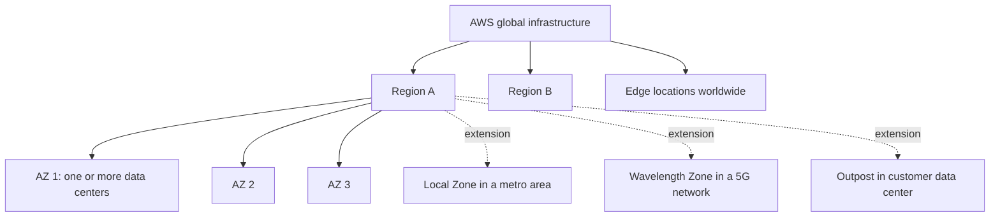

---
tags:
  - clf-c02
  - domain-3
  - task-statement
domain: 3
task: "3.2"
domain_weight: "34%"
status: not-started
aliases:
  - Task 3.2
---
# 3.2 Define the AWS global infrastructure

> [!abstract] Exam guide objective (verbatim from the CLF-C02 exam guide)
> **Knowledge of:**
> - AWS Regions, Availability Zones, and edge locations
> - High availability
> - Use of multiple Regions
> - Benefits of edge locations
> - AWS Wavelength Zones and AWS Local Zones
>
> **Skills in:**
> - Describing relationships among Regions, Availability Zones, and edge locations
> - Describing how to achieve high availability by using multiple Availability Zones
> - Recognizing that Availability Zones do not share single points of failure
> - Describing when to use multiple Regions (for example, disaster recovery, business continuity, low latency for end users, data sovereignty)
> - Describing at a high level the benefits of edge locations (for example, Amazon CloudFront, AWS Global Accelerator)

## Big picture

AWS's physical footprint is a hierarchy: Regions contain Availability Zones, which contain data centers, and a separate, much larger network of edge locations sits close to end users. The exam tests the definitions word for word, the relationships among them, and which layer solves which problem: **multiple AZs for high availability**, **multiple Regions for disaster recovery, data sovereignty, and global latency**, **edge locations for caching and fast entry to the AWS network**, and **Local Zones, Wavelength Zones, and Outposts for single-digit-millisecond latency to specific places**. Expect scenario questions such as "a company must keep data in Germany" (choose a Region) or "survive the loss of a data center" (deploy across AZs).

## Key concepts

### Definitions (reference guide wording)

| Component | Reference guide definition | Remember |
| --- | --- | --- |
| **Region** | "Isolated geographic area that consists of multiple Availability Zones" | Each Region is independent; you choose where your resources live. AWS: at least ==three AZs per Region==. |
| **Availability Zone (AZ)** | "One or more data centers within a Region" | Each AZ has redundant power, networking, and connectivity. AZs in a Region are many kilometers apart but ==within 100 km (60 miles)== of each other, linked by high-bandwidth, low-latency private networking. |
| **Edge location** | "A worldwide network of data centers that optimizes latency and throughput to users" | Far more edge locations than Regions; used by CloudFront, Global Accelerator, Route 53, and AWS Shield/WAF at the edge. |
| **AWS Local Zones** | "Provides low-latency access to applications by placing AWS resources close to large population and industry centers" | An extension of a parent Region into a metro area; runs select services (EC2, EBS, some databases). |
| **AWS Wavelength** (Wavelength Zones) | "Build applications that deliver ultra-low latencies to mobile devices and end users through 5G networks" | AWS compute and storage embedded in telecom providers' 5G networks. |
| **AWS Outposts** | "Extends AWS infrastructure, services, APIs, and tools to customer premises" | AWS hardware in your own data center (see [[3.1 Deploying and Operating in the AWS Cloud]]). |

### Relationships

- A Region **contains** multiple AZs; an AZ **contains** one or more data centers. An AZ belongs to exactly one Region.
- Edge locations are **not** inside AZs; they are a separate global network located in many more cities than Regions, connected to Regions over the AWS backbone.
- Local Zones, Wavelength Zones, and Outposts are each **anchored to a parent Region** and extend it closer to users or into your premises.
- Most services are **Regional** (EC2, RDS, VPC, S3 buckets live in a Region you choose). A few are **global**: IAM, Route 53, CloudFront, AWS Organizations.

### Choosing a Region: four factors

| Factor | Question to ask | Example |
| --- | --- | --- |
| **Compliance and data sovereignty** | Do laws or contracts require data to stay in a country? | Data about EU citizens kept in an EU Region. This usually decides first. |
| **Latency (proximity to users)** | Where are most customers? | Users in Australia, so use the Sydney Region. |
| **Service availability** | Is the service or feature offered in that Region? | New services launch in some Regions first. |
| **Pricing** | Prices differ by Region | The same instance type costs more in some Regions. |

Mnemonic: **C-L-A-P** (Compliance, Latency, Availability of services, Pricing). Data does not leave a Region unless you move or replicate it.

### High availability with multiple AZs

**High availability** means a system keeps working when a component fails. Because AZs are physically separate, with independent power, cooling, and networking, ==AZs do not share single points of failure==: a fire, flood, or power failure in one AZ should not take down another.

How you achieve it:

- Run copies of your application in **at least two AZs** behind an **Elastic Load Balancer**, which sends traffic only to healthy targets.
- Use **EC2 Auto Scaling** across AZs to replace failed instances.
- Use **RDS Multi-AZ** for a standby database in another AZ with automatic failover ([[3.4 Database Services]]).
- Many managed services are multi-AZ automatically (S3 Standard stores data across at least three AZs; DynamoDB replicates across three AZs).

A single EC2 instance in one AZ is **not** highly available, however large it is.

### When to use multiple Regions

Multiple AZs protect against a data center or AZ failure. Use **multiple Regions** when you need:

- **Disaster recovery (DR) and business continuity**: survive the loss of an entire Region (rare, large-scale events).
- **Low latency for a global user base**: serve users from the Region nearest them.
- **Data sovereignty**: keep each country's data in its own Region while operating globally.

Multi-Region designs cost more and add complexity (data replication, data transfer charges between Regions). Tools that help: CloudFormation to deploy the same stack in each Region, Route 53 routing, cross-Region replication (S3, RDS read replicas, DynamoDB global tables, Aurora Global Database).

### Edge locations and their benefits

Edge locations bring content and network entry points close to users, which lowers latency and offloads traffic from your origin.

| Service | What it does at the edge | Use it for |
| --- | --- | --- |
| **Amazon CloudFront** | Content delivery network (CDN): "speed up distribution of static and dynamic web content to end users through edge locations." Caches copies at the edge. | Websites, images, video, APIs; anything that can be **cached**. Works with AWS Shield and AWS WAF. |
| **AWS Global Accelerator** | "Improve availability and performance of applications through a global network of endpoints." Gives two static anycast IP addresses; traffic enters the AWS network at the nearest edge location and travels the AWS backbone to the best healthy endpoint. | Non-HTTP (TCP/UDP) traffic such as gaming or VoIP, static IPs, fast Regional failover. **No caching.** |

Route 53 (DNS) also answers from edge locations. Network details: [[3.5 Network Services]].

### Local Zones vs Wavelength Zones vs Outposts

| | Local Zones | Wavelength Zones | Outposts |
| --- | --- | --- | --- |
| Where | AWS-run site in a large metro area | Inside a telecom carrier's 5G network | Customer's own data center |
| Who runs the facility | AWS | Telecom partner hosts; AWS services | Customer site, AWS-managed hardware |
| Target users | People and systems in that city | Mobile devices and connected devices on 5G | On-site systems |
| Signal words | "single-digit millisecond latency to users in a specific city", "media rendering, real-time gaming" | "5G", "mobile", "ultra-low latency to mobile devices" | "on premises", "data residency in own facility", "hybrid" |

## Services to know

| Service | Purpose | Signal in a question |
| --- | --- | --- |
| [[Services - Compute#AWS Local Zones\|AWS Local Zones]] | AWS resources near large population and industry centers | "low latency for users in a specific metro area" |
| [[Services - Compute#AWS Wavelength\|AWS Wavelength]] | AWS compute and storage inside 5G networks | "5G", "mobile edge" |
| [[Services - Compute#AWS Outposts\|AWS Outposts]] | AWS infrastructure on customer premises | "on premises", "same APIs in our data center" |
| [[Services - Networking and Content Delivery#Amazon CloudFront\|Amazon CloudFront]] | CDN caching content at edge locations | "cache", "static content", "global website speed" |
| [[Services - Networking and Content Delivery#AWS Global Accelerator\|AWS Global Accelerator]] | Static anycast IPs, traffic over the AWS backbone | "static IP", "TCP/UDP", "gaming", "fast failover across Regions" |
| [[Services - Networking and Content Delivery#Amazon Route 53\|Amazon Route 53]] | DNS with health checks and routing policies | "domain name", "route users to nearest Region" |
| [[Services - Compute#Elastic Load Balancing (ELB)\|Elastic Load Balancing]] | Spreads traffic across AZs | "distribute traffic across multiple AZs" |

## Exam traps and commonly confused

> [!warning] AZ vs data center
> An AZ is **one or more** data centers, not exactly one. A Region is **multiple** AZs.

> [!warning] Edge location vs AZ vs Region
> You cannot launch EC2 instances in an edge location. Edge locations serve CloudFront, Global Accelerator, Route 53, and edge security. Compute runs in AZs (or in Local Zones, Wavelength Zones, Outposts).

> [!warning] High availability vs disaster recovery
> "Survive a data center failure" means **multiple AZs**. "Survive a Region-wide outage" or "keep data in another country" means **multiple Regions**.

> [!warning] CloudFront vs Global Accelerator
> Both use edge locations. CloudFront **caches** HTTP(S) content. Global Accelerator **does not cache**; it routes TCP/UDP traffic over the AWS network and gives **static IP addresses**.

> [!warning] Local Zones vs Wavelength vs Outposts
> City (Local Zones) vs 5G carrier network (Wavelength) vs your building (Outposts).

> [!warning] First factor for choosing a Region
> If a question includes a legal or regulatory requirement, **compliance/data sovereignty** decides first, even if another Region is cheaper or closer.

## Quick self-check

> [!question]- How does the reference guide define an Availability Zone?
> One or more data centers within a Region.

> [!question]- What is the minimum number of AZs AWS builds into a Region?
> Three.

> [!question]- How do you make an EC2-based web application highly available within a Region?
> Run instances in multiple Availability Zones behind an Elastic Load Balancer, with Auto Scaling.

> [!question]- Name the four factors for choosing a Region.
> Compliance/data sovereignty, latency to users, service availability, pricing.

> [!question]- A company must survive the loss of an entire Region. What design addresses this?
> A multi-Region deployment (disaster recovery in a second Region).

> [!question]- Which AWS infrastructure option targets ultra-low latency for mobile devices over 5G?
> AWS Wavelength (Wavelength Zones).

> [!question]- Which edge service caches static content close to viewers?
> Amazon CloudFront.

> [!question]- Which edge service provides static IP addresses and routes traffic over the AWS global network without caching?
> AWS Global Accelerator.

> [!question]- Why does deploying across AZs improve availability?
> AZs are physically separate with independent power, cooling, and networking, so they do not share single points of failure.

## AWS references

- [AWS Global Infrastructure](https://aws.amazon.com/about-aws/global-infrastructure/): map and current counts of Regions, AZs, and edge locations.
- [Regions and Availability Zones](https://aws.amazon.com/about-aws/global-infrastructure/regions_az/): AZ definition, three-AZ minimum, 100 km spacing.
- [AWS Local Zones](https://aws.amazon.com/about-aws/global-infrastructure/localzones/): product page.
- [What is AWS Local Zones?](https://docs.aws.amazon.com/local-zones/latest/ug/what-is-aws-local-zones.html): user guide.
- [What is AWS Wavelength?](https://docs.aws.amazon.com/wavelength/latest/developerguide/what-is-wavelength.html): Wavelength Zones in 5G networks.
- [What is Amazon CloudFront?](https://docs.aws.amazon.com/AmazonCloudFront/latest/DeveloperGuide/Introduction.html): CDN overview.
- [What is AWS Global Accelerator?](https://docs.aws.amazon.com/global-accelerator/latest/dg/what-is-global-accelerator.html): static IPs and the AWS backbone.
- [AWS Fault Isolation Boundaries whitepaper](https://docs.aws.amazon.com/whitepapers/latest/aws-fault-isolation-boundaries/abstract-and-introduction.html): why AZs and Regions isolate failures.

---
Up: [[Domain 3 Overview]] · Cards: [[Flashcards - Domain 3 (Part 1)]] · Practice: [[Practice - Domain 3 (Part 1)]] · Home: [[00 - Start Here]]
