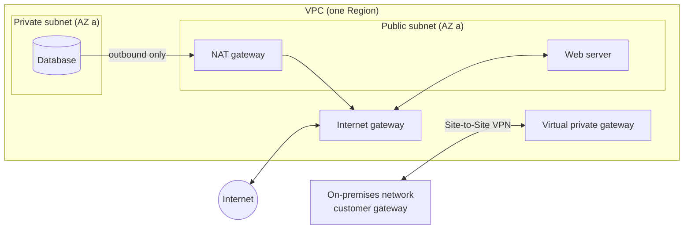

---
tags:
  - clf-c02
  - domain-3
  - task-statement
domain: 3
task: "3.5"
domain_weight: "34%"
status: not-started
aliases:
  - Task 3.5
---
# 3.5 Identify AWS network services

> [!abstract] Exam guide objective (verbatim from the CLF-C02 exam guide)
> **Knowledge of:**
> - AWS network services
>
> **Skills in:**
> - Identifying the components of a VPC (for example, subnets, gateways)
> - Understanding security in a VPC (for example, network ACLs, security groups)
> - Understanding the purpose of Amazon Route 53
> - Identifying edge services (for example, CloudFront, Global Accelerator)
> - Identifying network connectivity options to AWS (for example AWS VPN, Direct Connect)

## Big picture

This objective is about recognizing the parts of AWS networking, not configuring them. Expect short scenarios that describe a need and ask you to pick a component: "instances in a private subnet need to download patches" (NAT gateway), "a dedicated private connection that does not use the internet" (Direct Connect), "a firewall at the subnet level that can deny traffic" (network ACL). Route 53 questions test its three jobs (domain registration, DNS routing, health checks). Edge questions test whether content is cached (CloudFront) or traffic is just routed over the AWS backbone (Global Accelerator). The reference guide's one-line gateway definitions are worth memorizing word for word.

## Key concepts

### Amazon VPC and its building blocks

An **Amazon Virtual Private Cloud (VPC)** lets you "launch AWS resources in logically isolated virtual networks." A VPC lives in one Region and spans all of that Region's Availability Zones. You choose its private IP address range (a CIDR block, for example 10.0.0.0/16).

| Component | What it is |
|---|---|
| **Subnet** | A range of IP addresses inside a VPC, placed in ==exactly one Availability Zone==. You spread subnets across AZs for high availability. |
| **Public subnet** | A subnet whose route table sends internet-bound traffic (0.0.0.0/0) to an **internet gateway**. Used for web servers and load balancers. |
| **Private subnet** | A subnet with no route to an internet gateway. Used for databases and application servers. It can reach out through a NAT gateway. |
| **Route table** | A set of rules (routes) that decides where network traffic from a subnet goes. Every subnet is associated with one route table. |
| **Elastic IP address** | A static public IPv4 address you can attach to a resource. |
| **VPC peering** | A private connection between two VPCs (same or different account or Region) so they talk using private IPs. Not transitive: if A peers with B and B with C, A cannot reach C through B. |
| **VPC endpoint** | Private connection from a VPC to supported AWS services (such as S3 or DynamoDB) without going over the internet, an internet gateway, or a NAT gateway. Gateway endpoints serve S3 and DynamoDB; interface endpoints use AWS PrivateLink. |

### The six gateways (reference guide definitions)

These are quoted from the AWS reference guide. Learn the wording.

| Gateway | Reference guide definition | Memory hook |
|---|---|---|
| **Internet gateway** | "an Amazon VPC component that allows communication between a user's computer and the internet" | The VPC's front door to the internet, two-way. Makes a subnet public. |
| **NAT gateway** | "a network address translation service that gives instances in a private subnet the ability to connect to services outside of the user's Amazon VPC" | ==Outbound only==. Private instances can reach out (patches, updates); the internet cannot start a connection in. Lives in a public subnet. |
| **Virtual private gateway** | "the gateway on the AWS side of an AWS Site-to-Site VPN connection" | AWS end of the VPN tunnel. |
| **Customer gateway** | "a physical or software appliance that a user owns and manages on premises" | Your end of the VPN tunnel. |
| **AWS Transit Gateway** | "connects Amazon VPCs, AWS accounts, and on-premises networks to a single gateway" | Hub and spoke. Replaces a mesh of many peering connections. |
| **Direct Connect gateway** | "establishes connectivity that spans Amazon VPCs spread across multiple Regions" | One Direct Connect link reaches VPCs in many Regions. |

### Security in a VPC: security groups vs network ACLs

Both are virtual firewalls, and both are the customer's responsibility to configure under the shared responsibility model.

| | Security group | Network ACL (NACL) |
|---|---|---|
| Applies to | ==Instance level== (the network interface of an EC2 instance, RDS database, and so on) | ==Subnet level== (every resource in the subnet) |
| State | ==Stateful==: if a request is allowed in, the reply is automatically allowed out | ==Stateless==: return traffic must be allowed explicitly by a rule |
| Rule types | Allow rules only | Allow and deny rules |
| Rule evaluation | All rules evaluated together | Rules evaluated in number order, first match wins |
| Default | New security group: denies all inbound, allows all outbound | Default NACL: allows all inbound and outbound |
| Typical use | "Allow HTTPS from anywhere to the web servers" | "Block this specific IP address range from the whole subnet" |

Mnemonic: **S**ecurity group = **S**tateful, **S**ingle instance. **N**ACL = **N**ot stateful, **N**etwork subnet, can say **N**o (deny).

Related services owned by other notes: AWS WAF (filters HTTP requests by rules, layer 7), AWS Shield (DDoS protection), AWS Network Firewall (intrusion detection and prevention for a VPC). See [[2.4 Security Components and Resources]].

### Amazon Route 53

Route 53 is AWS's DNS (Domain Name System) service. DNS translates a name such as `www.example.com` into an IP address. Reference guide: "DNS service for domain registration, DNS routing, and health checking." Three jobs:

1. **Domain registration**: buy and renew domain names.
2. **DNS routing**: answer DNS queries and send users to your resources (an ELB, a CloudFront distribution, an S3 website, an IP address).
3. **Health checks**: monitor endpoints and stop sending traffic to unhealthy ones.

Routing policies (recognition level):

| Policy | Sends users to… |
|---|---|
| Simple | One resource |
| Weighted | Several resources in proportions you set (for example 90/10 for testing a new version) |
| Latency-based | The Region with the lowest latency for that user |
| Failover | A primary resource, and a standby if the health check fails (active-passive DR) |
| Geolocation | A resource chosen by the user's location (country or continent), for example for language or legal content rules |
| Geoproximity | A resource chosen by geographic distance, with an adjustable bias |
| Multivalue answer | Up to several healthy resources, chosen at random |
| IP-based | A resource chosen by the user's source IP range |

### Edge services: CloudFront vs Global Accelerator

Both use AWS edge locations (see [[3.2 AWS Global Infrastructure]]) to bring users onto the AWS global network close to where they are.

| | Amazon CloudFront | AWS Global Accelerator |
|---|---|---|
| Reference guide | "speed up distribution of static and dynamic web content to end users through edge locations" | "improve availability and performance of applications through a global network of endpoints" |
| What it does | Content delivery network (CDN): ==caches copies== of content at edge locations | ==Does not cache==. Routes TCP and UDP traffic over the AWS backbone to the best healthy endpoint |
| Gives you | A distribution domain name; origins such as S3, ELB, EC2 | ==Two static anycast IP addresses== in front of your application |
| Typical cue | Website images and video load slowly for global users; static website on S3 | Gaming, VoIP, IoT (non-HTTP); need fixed IPs for allow-listing; fast failover between Regions |
| Security extras | Integrates with AWS WAF, AWS Shield, ACM certificates (HTTPS) | AWS Shield Standard protection |

### Connectivity options from on premises to AWS

| Option | What it is | Speed to set up | Path | Cue |
|---|---|---|---|---|
| **AWS Site-to-Site VPN** | Encrypted IPsec tunnel between your network (customer gateway) and AWS (virtual private gateway or Transit Gateway) | Minutes to hours | ==Over the public internet==, encrypted | "Quick, low-cost, encrypted connection from the data center" |
| **AWS Client VPN** | Managed VPN for individual users' devices (laptops) to reach AWS and on-premises resources | Minutes | Over the internet, encrypted (OpenVPN-based client) | "Remote employees need secure access" |
| **AWS Direct Connect** | "a private dedicated network connection from an on-premises data center to the cloud" | Weeks (a physical circuit is provisioned at a Direct Connect location) | ==Does not use the public internet== | "Consistent network performance", "dedicated", "large ongoing data transfer", "reduce data transfer costs" |
| **Public internet** | Reach public AWS endpoints directly over HTTPS | Immediate | Internet | Default, no extra service |

Notes worth knowing:
- Direct Connect traffic is private but **not encrypted by default**. For encryption on top of Direct Connect, run a Site-to-Site VPN over it.
- A common resilient design uses Direct Connect as the primary path and Site-to-Site VPN as the backup.
- Both VPN types fall under the **AWS VPN** service ("establish a secure and private tunnel from on premises to the cloud").

### Amazon API Gateway

API Gateway lets you "create, publish, and monitor REST, HTTP, and WebSocket APIs at any scale." It is the managed "front door" for applications, commonly in front of AWS Lambda for serverless backends. It handles request throttling, authorization, and monitoring. Do not confuse it with the networking gateways above: API Gateway is about application APIs, not routing network packets.

## Services to know

| Service | Purpose (one line) | Question cue |
|---|---|---|
| [[Services - Networking and Content Delivery#Amazon VPC\|Amazon VPC]] | Logically isolated virtual network | "isolated network", "subnets", "private IP range" |
| [[Services - Networking and Content Delivery#AWS Transit Gateway\|AWS Transit Gateway]] | Hub connecting many VPCs and on-premises networks | "connect hundreds of VPCs", "simplify peering mesh" |
| [[Services - Networking and Content Delivery#Amazon Route 53\|Amazon Route 53]] | DNS: domain registration, routing, health checks | "register a domain", "DNS", "route users to the closest Region", "failover" |
| [[Services - Networking and Content Delivery#Amazon CloudFront\|Amazon CloudFront]] | CDN that caches content at edge locations | "cache", "reduce latency for global users", "static and dynamic web content" |
| [[Services - Networking and Content Delivery#AWS Global Accelerator\|AWS Global Accelerator]] | Routes traffic over the AWS global network to optimal endpoints | "static IP addresses", "TCP/UDP", "non-HTTP", "no caching" |
| [[Services - Networking and Content Delivery#AWS VPN\|AWS VPN]] | Encrypted tunnels over the internet (Site-to-Site, Client) | "encrypted", "over the internet", "quickly", "remote users" |
| [[Services - Networking and Content Delivery#AWS Direct Connect\|AWS Direct Connect]] | Private dedicated connection to AWS | "dedicated", "private", "consistent performance", "bypass internet" |
| [[Services - Networking and Content Delivery#Amazon API Gateway\|Amazon API Gateway]] | Create, publish, monitor APIs | "REST API", "WebSocket", "front door for Lambda" |

## Exam traps and commonly confused

> [!warning] Security group vs network ACL
> Need to **deny** a specific IP address? Only a network ACL can. Security groups have allow rules only. "Stateful" means security group; "stateless" means NACL; "subnet level" means NACL; "instance level" means security group.

> [!warning] Internet gateway vs NAT gateway
> Internet gateway = two-way internet access for public subnets. NAT gateway = outbound-only internet access for instances in **private** subnets. "Private instances must download updates but must not be reachable from the internet" → NAT gateway.

> [!warning] Virtual private gateway vs customer gateway
> Virtual private gateway is on the **AWS side** of the VPN. Customer gateway is the device **on premises** that the customer owns and manages.

> [!warning] Transit Gateway vs VPC peering vs Direct Connect gateway
> VPC peering joins two VPCs, one-to-one, not transitive. Transit Gateway is a hub for many VPCs, accounts, and on-premises networks. Direct Connect gateway lets one Direct Connect connection reach VPCs in multiple Regions.

> [!warning] CloudFront vs Global Accelerator
> Caching → CloudFront. Static anycast IPs, TCP/UDP, no caching → Global Accelerator. Both use edge locations.

> [!warning] VPN vs Direct Connect
> VPN travels over the public internet (encrypted) and is fast to set up. Direct Connect is private and dedicated, gives consistent performance, takes weeks to provision, and is not encrypted by default.

> [!warning] Route 53 vs CloudFront for "send users to the nearest Region"
> Route 53 latency-based or geolocation routing chooses which endpoint a user is sent to. CloudFront caches content near the user. If the question is about DNS or choosing among Regional endpoints, it is Route 53.

> [!warning] API Gateway is not a network gateway
> API Gateway manages application APIs. If the question is about connecting networks, look at the six networking gateways instead.

## Quick self-check

> [!question]- Which VPC firewall is stateless and applies at the subnet level?
> Network ACL.

> [!question]- A company must block traffic from one malicious IP range to an entire subnet. What should it use?
> A network ACL deny rule. Security groups cannot deny.

> [!question]- Instances in a private subnet need to reach the internet for software updates without accepting inbound connections. What is needed?
> A NAT gateway (placed in a public subnet).

> [!question]- What is the gateway on the AWS side of a Site-to-Site VPN called?
> Virtual private gateway. The on-premises side is the customer gateway.

> [!question]- Name the three main functions of Amazon Route 53.
> Domain registration, DNS routing, and health checking.

> [!question]- Which edge service gives two static IP addresses and does not cache content?
> AWS Global Accelerator.

> [!question]- A company needs consistent network performance between its data center and AWS without using the public internet. Which service?
> AWS Direct Connect.

> [!question]- A company needs to connect 50 VPCs and its on-premises network through one central hub. Which service?
> AWS Transit Gateway.

> [!question]- What makes a subnet "public"?
> Its route table has a route to an internet gateway.

## AWS references

- [What is Amazon VPC?](https://docs.aws.amazon.com/vpc/latest/userguide/what-is-amazon-vpc.html) — VPC concepts: subnets, route tables, gateways.
- [Security groups](https://docs.aws.amazon.com/vpc/latest/userguide/vpc-security-groups.html) and [Network ACLs](https://docs.aws.amazon.com/vpc/latest/userguide/vpc-network-acls.html) — the two VPC firewalls.
- [Internet gateways](https://docs.aws.amazon.com/vpc/latest/userguide/VPC_Internet_Gateway.html) and [NAT gateways](https://docs.aws.amazon.com/vpc/latest/userguide/vpc-nat-gateway.html) — internet access for public and private subnets.
- [What is a transit gateway?](https://docs.aws.amazon.com/vpc/latest/tgw/what-is-transit-gateway.html) — hub for VPCs and on-premises networks.
- [What is VPC peering?](https://docs.aws.amazon.com/vpc/latest/peering/what-is-vpc-peering.html) — one-to-one VPC connections.
- [AWS PrivateLink concepts](https://docs.aws.amazon.com/vpc/latest/privatelink/concepts.html) — VPC endpoints.
- [What is Amazon Route 53?](https://docs.aws.amazon.com/Route53/latest/DeveloperGuide/Welcome.html) and [Routing policies](https://docs.aws.amazon.com/Route53/latest/DeveloperGuide/routing-policy.html).
- [What is Amazon CloudFront?](https://docs.aws.amazon.com/AmazonCloudFront/latest/DeveloperGuide/Introduction.html) — the CDN.
- [What is AWS Global Accelerator?](https://docs.aws.amazon.com/global-accelerator/latest/dg/what-is-global-accelerator.html) — static anycast IPs, backbone routing.
- [AWS Site-to-Site VPN](https://docs.aws.amazon.com/vpn/latest/s2svpn/VPC_VPN.html) and [AWS Client VPN](https://docs.aws.amazon.com/vpn/latest/clientvpn-admin/what-is.html) — the two VPN types.
- [What is AWS Direct Connect?](https://docs.aws.amazon.com/directconnect/latest/UserGuide/Welcome.html) — dedicated private connection.
- [What is Amazon API Gateway?](https://docs.aws.amazon.com/apigateway/latest/developerguide/welcome.html) — managed APIs.
- Cheat sheet: [[Networking and Gateways]].

---
Up: [[Domain 3 Overview]] · Cards: [[Flashcards - Domain 3 (Part 2)]] · Practice: [[Practice - Domain 3 (Part 2)]] · Home: [[00 - Start Here]]
