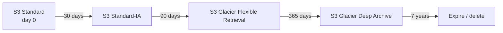

---
tags:
  - clf-c02
  - domain-3
  - task-statement
domain: 3
task: "3.6"
domain_weight: "34%"
status: not-started
aliases:
  - Task 3.6
---
# 3.6 Identify AWS storage services

> [!abstract] Exam guide objective (verbatim from the CLF-C02 exam guide)
> **Knowledge of:**
> - AWS storage services
>
> **Skills in:**
> - Identifying the uses for object storage
> - Recognizing the differences in Amazon S3 storage classes
> - Identifying block storage solutions (for example, Amazon Elastic Block Store [Amazon EBS], instance store)
> - Identifying file services (for example, Amazon Elastic File System [Amazon EFS], Amazon FSx)
> - Identifying cached file systems (for example, AWS Storage Gateway)
> - Understanding use cases for lifecycle policies
> - Understanding use cases for AWS Backup

## Big picture

Storage questions start by sorting the need into one of three types: object (S3), block (EBS, instance store), or file (EFS, FSx). Then they test which S3 storage class fits an access pattern and a retrieval-time requirement, which is where most points are won or lost. Expect "data is accessed rarely but must be available in milliseconds" (S3 Glacier Instant Retrieval), "data can be re-created and cost matters most" (S3 One Zone-IA), and "keep for 7 years, retrieval within 48 hours is fine" (S3 Glacier Deep Archive). Hybrid questions point to AWS Storage Gateway, and "centralize backups across services" points to AWS Backup.

## Key concepts

### Object vs block vs file storage

| Type | How data is stored and reached | AWS services | Typical use |
|---|---|---|---|
| **Object** | Whole objects (file plus metadata plus a unique key) in a flat bucket, reached over HTTPS through an API. To change an object you rewrite the whole object. | Amazon S3, S3 Glacier storage classes | Backups, data lakes, media, static websites, logs, archives |
| **Block** | Data split into fixed-size blocks on a volume that an operating system formats and mounts like a local disk. Small parts can change in place. | Amazon EBS, EC2 instance store | Boot volumes, databases on EC2, transactional workloads needing low latency |
| **File** | Hierarchical folders and files shared over a network protocol (NFS or SMB) by many clients at once. | Amazon EFS, Amazon FSx | Shared content, home directories, lift-and-shift apps expecting a file share |

### Amazon S3 basics

Amazon S3 is "scalable object storage in the cloud."

- **Bucket**: container for objects. Bucket names are globally unique; a bucket is created in one Region.
- **Object**: the data plus metadata, found by its **key** (name). A single object can be up to 5 TB.
- Storage is virtually unlimited and you pay for what you store, plus requests and data transfer out.
- Designed for ==99.999999999% (11 nines) durability== in every storage class.
- Uses: backup and restore, archive, data lakes for analytics, static website hosting, media hosting, software distribution.

### S3 storage classes

All figures are from the AWS S3 User Guide storage class comparison. All classes are designed for 11 nines durability. "Availability" is the designed-for figure.

| Storage class | Designed for | Availability | AZs | Min storage duration | Retrieval | Notes |
|---|---|---|---|---|---|---|
| **S3 Standard** | Frequently accessed data | 99.99% | ≥3 | None | Milliseconds | Default class. No retrieval fee. |
| **S3 Intelligent-Tiering** | Unknown or changing access patterns | 99.9% | ≥3 | None | Milliseconds (optional archive tiers: minutes to hours) | Small monthly monitoring and automation fee per object; ==no retrieval fees==. Moves objects between tiers automatically. |
| **S3 Standard-IA** | Infrequently accessed (about once a month), needs fast access | 99.9% | ≥3 | 30 days | Milliseconds | Per-GB retrieval fee. 128 KB minimum billable object size. |
| **S3 One Zone-IA** | Infrequent, ==re-creatable== data | 99.5% | ==1== | 30 days | Milliseconds | Cheaper than Standard-IA. Data lost if that AZ is destroyed. |
| **S3 Glacier Instant Retrieval** | Archive accessed about once a quarter, needs ==milliseconds== | 99.9% | ≥3 | 90 days | Milliseconds | Per-GB retrieval fee. 128 KB minimum billable size. |
| **S3 Glacier Flexible Retrieval** | Archive accessed about once a year | 99.99% (after restore) | ≥3 | 90 days | Expedited 1–5 min; Standard 3–5 hours; Bulk 5–12 hours | Objects must be restored before access. Bulk retrievals free. |
| **S3 Glacier Deep Archive** | Archive accessed less than once a year; long-term retention (7–10 years, compliance) | 99.99% (after restore) | ≥3 | ==180 days== | Standard within 12 hours; Bulk within 48 hours | ==Lowest-cost storage class==. No Expedited option. |
| **S3 on Outposts** (S3 Outposts class) | Data that must stay on premises | — | On your AWS Outposts | — | Local | S3 buckets on AWS Outposts hardware for local data residency and processing. Mention level only. |

How to remember the minimum durations: **IA = 30, Glacier = 90, Deep = 180** (doubling as you go colder after the first step). Intelligent-Tiering and Standard have none.

S3 Intelligent-Tiering tiers: Frequent Access → Infrequent Access (after 30 days without access) → Archive Instant Access (after 90 days). Optional Archive Access and Deep Archive Access tiers can be turned on. Objects under 128 KB are not monitored and stay in Frequent Access.

Current status: AWS has added **S3 Express One Zone** (single-digit millisecond access, one AZ, 99.95% availability) after the exam guide was written. It is not in the 2023 exam materials.

### S3 features at overview depth

| Feature | What it does | Use case cue |
|---|---|---|
| **Versioning** | Keeps every version of an object in the bucket. Deleting adds a "delete marker" instead of removing data, so earlier versions can be restored. Once enabled it can be suspended, not removed. | "Protect against accidental deletion or overwrite" |
| **Lifecycle policies** | Rules that automatically **transition** objects to cheaper classes after a set age, or **expire** (delete) them. | "Move logs to Standard-IA after 30 days and to Glacier after 90, delete after 7 years" |
| **Replication** | Automatically copies objects to another bucket: Cross-Region Replication (CRR) or Same-Region Replication (SRR). Requires versioning on source and destination. | "Copy data to another Region for compliance or DR", "lower latency copy" |
| **Static website hosting** | Serves HTML, CSS, JavaScript, and images straight from a bucket. No server-side code. Often paired with CloudFront (HTTPS, caching) and Route 53 (custom domain). | "Host a static website without servers" |
| **Object Lock** | Write-once-read-many (WORM): objects cannot be deleted or overwritten for a retention period. | "Regulatory requirement that records cannot be altered" |
| **S3 Transfer Acceleration** | Speeds long-distance uploads by routing through CloudFront edge locations. | "Users worldwide upload large files to one bucket" |

**Lifecycle policy use cases** (named in the objective): logs or data that cool over time, cutting cost by moving older data to IA or Glacier classes; deleting temporary files after N days; deleting old object versions when versioning is on; meeting a retention schedule (keep 7 years, then expire). If access patterns are unknown, S3 Intelligent-Tiering does the moving for you instead of fixed rules.

### Block storage: EBS vs instance store

**Amazon EBS** provides "block-level storage volumes for use with EC2 instances."

- An EBS volume is network-attached storage that ==persists independently== of the instance: data survives stop and start, and can survive termination (if delete-on-termination is off).
- A volume lives in ==one Availability Zone== and is replicated within that AZ. It attaches to instances in the same AZ.
- Volume types at the level the exam needs:
  - **SSD-backed** (General Purpose gp2/gp3, Provisioned IOPS io1/io2): transactional, IOPS-heavy work, boot volumes, databases.
  - **HDD-backed** (Throughput Optimized st1, Cold sc1): large sequential throughput such as big data and log processing; lowest cost; cannot be boot volumes.
- **EBS snapshots** are incremental point-in-time backups stored in Amazon S3 (managed by AWS). Use them to back up, to create new volumes in another AZ, or to copy to another Region.
- Can be encrypted at rest with AWS KMS.

**EC2 instance store** is disk physically attached to the host computer.

- ==Ephemeral==: data is lost when the instance stops, hibernates, or terminates, or if the underlying disk fails. Data survives a reboot.
- Very high I/O performance, included in the instance price.
- Use for temporary data: buffers, caches, scratch data, or data replicated across a fleet.

### File storage: EFS vs FSx

| | Amazon EFS | Amazon FSx |
|---|---|---|
| Reference guide | "serverless, fully scalable shared file system" | "launch, run, and scale file systems in the cloud" |
| Protocol | NFS | Depends on flavor (SMB for Windows; Lustre; NFS/SMB/iSCSI for ONTAP; NFS for OpenZFS) |
| Clients | ==Linux== EC2 instances, containers, Lambda, on-premises servers; thousands at once | Windows, Linux, macOS, HPC clusters |
| Scaling | Grows and shrinks automatically, pay for what you use | You choose capacity and performance |
| Resilience | Regional (data across multiple AZs), or One Zone option | Single-AZ or Multi-AZ deployment options (varies by flavor) |
| Storage classes | Standard, Infrequent Access, Archive (with lifecycle management) | Varies by flavor |

FSx flavors:
- **FSx for Windows File Server**: fully managed native Windows file shares over SMB, integrates with Microsoft Active Directory. Cue: "Windows applications", "SMB", "Active Directory".
- **FSx for Lustre**: high-performance parallel file system for HPC, machine learning, and media processing; can link to an S3 bucket. Cue: "high-performance computing", "sub-millisecond, hundreds of GB/s".
- **FSx for NetApp ONTAP** and **FSx for OpenZFS**: managed versions of those popular file systems, for moving existing NetApp or ZFS workloads (mention level).

### Hybrid and cached file systems: AWS Storage Gateway

AWS Storage Gateway lets you "connect an on-premises software appliance with cloud-based storage." It runs as a virtual machine (or hardware appliance) in your data center, keeps a **local cache** of frequently used data for low-latency access, and stores the full data set in AWS. This is the "cached file system" the objective names.

| Gateway type | Interface on premises | Where data lands in AWS | Cue |
|---|---|---|---|
| **S3 File Gateway** | File shares (NFS, SMB) | Objects in Amazon S3 | "On-premises apps write files that should end up in S3", "local cache of recently used files" |
| **Volume Gateway** | Block storage volumes (iSCSI) | S3, with backups as EBS snapshots. **Cached mode**: primary data in AWS, frequently accessed data cached locally. **Stored mode**: full data set on premises, backed up asynchronously to AWS | "Extend on-premises block storage", "back up local volumes to the cloud" |
| **Tape Gateway** | Virtual tape library (iSCSI VTL) used by existing backup software | S3, archived to S3 Glacier Flexible Retrieval or Deep Archive | "Replace physical tapes", "keep existing backup software" |

Current status: Amazon FSx File Gateway (a fourth type that cached FSx for Windows File Server shares on premises) has not been available to new customers since October 28, 2024.

### AWS Backup

AWS Backup lets you "centralize and automate backups of data from AWS storage services and on-premises storage systems."

- One place to define **backup plans** (schedules, retention, lifecycle to cold storage) and apply them to resources by tag.
- Covers services such as EC2, EBS, EFS, FSx, RDS, Aurora, DynamoDB, S3, Storage Gateway volumes, and on-premises VMware VMs.
- Cross-Region and cross-account backup copies for disaster recovery; works with AWS Organizations for central policies.
- Backup Vault Lock gives WORM protection so backups cannot be deleted.
- **Use cases**: compliance-driven retention ("keep daily backups for 35 days and monthly for 7 years"), replacing per-service scripts and snapshot jobs, central audit of backup activity, protecting against ransomware or accidental deletion.

### AWS Elastic Disaster Recovery

AWS Elastic Disaster Recovery (AWS DRS) "minimizes downtime and data loss from natural catastrophes, application failures, or disruptions of service." It continuously replicates on-premises or cloud servers at block level into a low-cost staging area in AWS, then launches recovery instances within minutes when needed (RPO of seconds, RTO of minutes). Cue: "fast recovery of physical, virtual, or cloud servers into AWS." It is the successor to CloudEndure Disaster Recovery.

### AWS Snow Family (overview)

Rugged physical devices that AWS ships to you for moving large amounts of data offline, or for computing at edge sites with little or no connectivity. Reference guide: "run operations in remote, non-data center environments, and locations without network connectivity."

| Device | Scale | Use |
|---|---|---|
| AWS Snowcone | Smallest, portable (terabytes) | Edge computing and transfer in tight spaces |
| AWS Snowball Edge | Tens to hundreds of terabytes per device; Storage Optimized or Compute Optimized | Data migration, edge computing (ships, field sites) |
| AWS Snowmobile | Shipping-container truck, up to 100 PB | Exabyte-scale data center migration |

Rule of thumb: if transferring over the network would take weeks or longer, the exam expects a Snow device. Detail lives in [[Services - Migration and Transfer#AWS Snow Family|AWS Snow Family]] and [[1.3 Migration Strategies and AWS CAF]].

Current status: AWS no longer offers Snow Family devices to new customers (Snowball Edge closed to new customers in November 2025; Snowmobile was retired in 2024). AWS now points new customers to AWS DataSync for online transfer, AWS Data Transfer Terminal for physical transfer, and AWS Outposts for edge compute. The exam still tests Snow Family.

## Services to know

| Service | Purpose (one line) | Question cue |
|---|---|---|
| [[Services - Storage#Amazon S3\|Amazon S3]] | Scalable object storage | "object", "unlimited", "static website", "data lake", "11 nines" |
| [[Services - Storage#Amazon S3 Glacier\|Amazon S3 Glacier]] storage classes | Low-cost archive classes inside S3 | "archive", "long-term retention", "rarely accessed", "hours to retrieve" |
| [[Services - Storage#Amazon Elastic Block Store (Amazon EBS)\|Amazon EBS]] | Persistent block volumes for EC2 | "boot volume", "database on EC2", "snapshot", "single AZ" |
| EC2 instance store (see [[Services - Compute#Amazon EC2\|Amazon EC2]]) | Temporary block storage on the host | "temporary", "cache", "buffer", "lost on stop" |
| [[Services - Storage#Amazon Elastic File System (Amazon EFS)\|Amazon EFS]] | Serverless shared NFS file system for Linux | "shared file system", "Linux", "many instances", "multiple AZs" |
| [[Services - Storage#Amazon FSx\|Amazon FSx]] | Managed third-party file systems | "Windows file share", "SMB", "Active Directory", "Lustre", "HPC" |
| [[Services - Storage#AWS Storage Gateway\|AWS Storage Gateway]] | Hybrid on-premises access to cloud storage with local cache | "on-premises", "hybrid", "local cache", "replace tapes" |
| [[Services - Storage#AWS Backup\|AWS Backup]] | Central, policy-based backups | "centralize backups", "across services", "retention policy" |
| [[Services - Storage#AWS Elastic Disaster Recovery\|AWS Elastic Disaster Recovery]] | Continuous replication and fast recovery of servers | "disaster recovery", "minimal downtime", "recover servers in minutes" |
| [[Services - Migration and Transfer#AWS Snow Family\|AWS Snow Family]] | Physical devices for offline transfer and edge compute | "petabytes", "limited bandwidth", "no connectivity", "remote site" |

## Exam traps and commonly confused

> [!warning] S3 Standard-IA vs S3 One Zone-IA
> Same 30-day minimum and millisecond access. One Zone-IA keeps data in one AZ (99.5% availability) and is cheaper, so use it only for data you can re-create. Standard-IA uses at least three AZs.

> [!warning] Glacier Instant vs Flexible vs Deep Archive
> Instant Retrieval: milliseconds, 90-day minimum. Flexible Retrieval: minutes to hours, 90-day minimum. Deep Archive: 12 to 48 hours, 180-day minimum, cheapest. "Rarely accessed but needs immediate access" → Glacier Instant Retrieval, not Flexible.

> [!warning] Intelligent-Tiering vs lifecycle policy
> Lifecycle policies move data on a fixed schedule you define. Intelligent-Tiering moves each object based on its actual access, for unknown or changing patterns, with a small per-object monitoring fee and no retrieval fees.

> [!warning] EBS vs instance store
> EBS persists after stop; instance store data is lost on stop or terminate. "Temporary" or "scratch" → instance store. "Persistent", "survive stop" → EBS.

> [!warning] EBS vs EFS
> EBS is one volume in one AZ, normally attached to one instance. EFS is a shared file system that many instances across multiple AZs mount at once.

> [!warning] EFS vs FSx for Windows File Server
> Linux and NFS → EFS. Windows, SMB, Active Directory → FSx for Windows File Server.

> [!warning] Storage Gateway vs DataSync vs Snow Family
> Storage Gateway: ongoing hybrid access with a local cache. AWS DataSync: online one-time or scheduled bulk copy. Snow Family: offline physical transfer when bandwidth is too limited.

> [!warning] AWS Backup vs Elastic Disaster Recovery
> AWS Backup: scheduled, policy-based backups and retention across many services. Elastic Disaster Recovery: continuous server replication for failover in minutes.

> [!warning] Durability vs availability
> Durability (11 nines in every class) is about not losing data. Availability (99.99% down to 99.5%) is about being able to reach it. One Zone-IA has the same durability as Standard but lower availability and no AZ resilience.

## Quick self-check

> [!question]- Which S3 storage class has the lowest storage cost and a 180-day minimum storage duration?
> S3 Glacier Deep Archive.

> [!question]- Medical images are rarely viewed but must be returned in milliseconds when requested. Which storage class is most cost-effective?
> S3 Glacier Instant Retrieval.

> [!question]- Which storage class stores data in a single Availability Zone, and what is its designed availability?
> S3 One Zone-IA, 99.5%.

> [!question]- Access patterns for a data set are unknown. Which S3 class optimizes cost automatically?
> S3 Intelligent-Tiering.

> [!question]- What happens to data on an EC2 instance store volume when the instance is stopped?
> It is lost. Instance store is ephemeral (data survives only a reboot).

> [!question]- Several Linux EC2 instances across multiple AZs need the same shared file system. Which service?
> Amazon EFS.

> [!question]- Which Storage Gateway type lets existing backup software write to virtual tapes stored in AWS?
> Tape Gateway.

> [!question]- What S3 feature automatically moves objects to cheaper classes or deletes them after a set number of days?
> S3 Lifecycle policies (transition and expiration actions).

> [!question]- Which service centrally manages backup schedules and retention for EBS, RDS, DynamoDB, and EFS?
> AWS Backup.

> [!question]- What is the minimum storage duration for S3 Standard-IA and for S3 Glacier Flexible Retrieval?
> 30 days and 90 days.

## AWS references

- [What is Amazon S3?](https://docs.aws.amazon.com/AmazonS3/latest/userguide/Welcome.html) — buckets, objects, features.
- [Understanding and managing Amazon S3 storage classes](https://docs.aws.amazon.com/AmazonS3/latest/userguide/storage-class-intro.html) — the official comparison table used for the figures above.
- [Understanding archive retrieval options](https://docs.aws.amazon.com/AmazonS3/latest/userguide/restoring-objects-retrieval-options.html) — Glacier Expedited, Standard, Bulk times.
- [Amazon S3 storage classes product page](https://aws.amazon.com/s3/storage-classes/) — use cases per class.
- [Managing the lifecycle of objects](https://docs.aws.amazon.com/AmazonS3/latest/userguide/object-lifecycle-mgmt.html), [Versioning](https://docs.aws.amazon.com/AmazonS3/latest/userguide/Versioning.html), [Replication](https://docs.aws.amazon.com/AmazonS3/latest/userguide/replication.html), [Static website hosting](https://docs.aws.amazon.com/AmazonS3/latest/userguide/WebsiteHosting.html).
- [Block vs file vs object storage](https://aws.amazon.com/compare/the-difference-between-block-file-object-storage/) — AWS comparison page.
- [What is Amazon EBS?](https://docs.aws.amazon.com/ebs/latest/userguide/what-is-ebs.html) and [EBS volume types](https://docs.aws.amazon.com/ebs/latest/userguide/ebs-volume-types.html).
- [Instance store](https://docs.aws.amazon.com/AWSEC2/latest/UserGuide/InstanceStorage.html) — ephemeral block storage.
- [What is Amazon EFS?](https://docs.aws.amazon.com/efs/latest/ug/whatisefs.html) and [Amazon FSx product page](https://aws.amazon.com/fsx/).
- [What is AWS Storage Gateway?](https://docs.aws.amazon.com/storagegateway/latest/userguide/WhatIsStorageGateway.html) — gateway types.
- [What is AWS Backup?](https://docs.aws.amazon.com/aws-backup/latest/devguide/whatisbackup.html)
- [What is AWS Elastic Disaster Recovery?](https://docs.aws.amazon.com/drs/latest/userguide/what-is-drs.html)
- [Snowball Edge availability change](https://docs.aws.amazon.com/snowball/latest/developer-guide/snowball-edge-availability-change.html) — current status of the Snow Family.
- Cheat sheets: [[S3 Storage Classes]], [[Storage Picker]].

---
Up: [[Domain 3 Overview]] · Cards: [[Flashcards - Domain 3 (Part 2)]] · Practice: [[Practice - Domain 3 (Part 2)]] · Home: [[00 - Start Here]]
