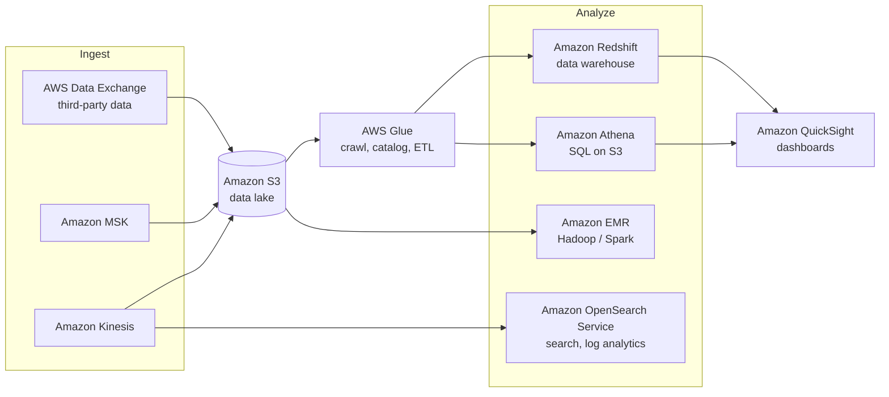

---
tags:
  - clf-c02
  - domain-3
  - task-statement
domain: 3
task: "3.7"
domain_weight: "34%"
status: not-started
aliases:
  - Task 3.7
---
# 3.7 Identify AWS artificial intelligence and machine learning (AI/ML) services and analytics services

> [!abstract] Exam guide objective (verbatim from the CLF-C02 exam guide)
> **Knowledge of:**
> - AWS AI/ML services
> - AWS analytics services
>
> **Skills in:**
> - Understanding the different AI/ML services and the tasks that they accomplish (for example, Amazon SageMaker, Amazon Lex, Amazon Kendra)
> - Identifying the services for data analytics (for example, Amazon Athena, Amazon Kinesis, AWS Glue, Amazon QuickSight)

## Big picture

This objective is pure matching: a scenario describes a task and you pick the service. For AI/ML, the key is to tie each service to the kind of input it takes (text, speech, images, documents) and the output it produces. Only SageMaker is for building your own models; the others are ready-made AI services you call through an API with no ML expertise. For analytics, place each service on the data pipeline: collect streams (Kinesis, MSK), prepare and catalog (Glue), query (Athena, Redshift, EMR, OpenSearch), and visualize (QuickSight). Most wrong answers on the exam are a neighboring service on that same pipeline.

## Key concepts

### Two layers of AWS AI/ML

- **Build your own models**: **Amazon SageMaker** is for data scientists and developers to "build and train ML models, then deploy the models in a production-ready hosted environment." You bring data, choose or write algorithms, train, tune, and host.
- **Pre-trained AI services**: call an API and get a result. No ML knowledge needed. Each one does one job.

### AI services by input type

| Input | Service | Task it accomplishes (reference guide) |
|---|---|---|
| Speech (audio) → text | **Amazon Transcribe** | "automatic speech recognition that converts audio to text" |
| Text → speech | **Amazon Polly** | "convert text into lifelike speech" |
| Text → another language | **Amazon Translate** | "translate unstructured text documents or build applications that work in multiple languages" |
| Text → meaning | **Amazon Comprehend** | "uses natural language processing (NLP) to extract insights from documents" (sentiment, key phrases, entities, language, PII) |
| Conversation (voice or text) | **Amazon Lex** | "build conversational interfaces for applications that use voice and text" (chatbots; same technology as Alexa) |
| Question → answer from company documents | **Amazon Kendra** | "intelligent search service that uses NLP and ML algorithms" (enterprise search across documents, wikis, intranets) |
| Images and video | **Amazon Rekognition** | "identify objects, people, text, scenes, and activities in images and videos" (including face comparison and content moderation) |
| Scanned documents and forms | **Amazon Textract** | "automatically extract text, handwriting, and data from scanned documents" (keeps form fields and table structure) |
| Your own data → custom model | **Amazon SageMaker** | Build, train, deploy custom ML models |

Memory hooks: **Polly** the parrot talks (text to speech). **Transcribe** writes down what was said. **Lex** = lexicon, the chatbot. **Kendra** = search ("Kendra, find it"). **Rekognition** = recognize what is in a picture. **Textract** = extract text from documents. **Comprehend** = understand what text means.

### Question cue to service

| If the question says… | Answer |
|---|---|
| Create subtitles or captions from video audio; transcribe call recordings | Amazon Transcribe |
| Read articles aloud; give an app a lifelike voice | Amazon Polly |
| Localize a website or support chat into other languages | Amazon Translate |
| Detect sentiment in customer reviews or social posts; find key phrases, entities, or PII in text | Amazon Comprehend |
| Build a chatbot or voice bot for customer service | Amazon Lex |
| Employees ask natural-language questions and get answers from internal documents | Amazon Kendra |
| Identify faces, objects, celebrities, or unsafe content in photos or video; verify a user's face | Amazon Rekognition |
| Pull data out of invoices, tax forms, insurance claims, handwriting | Amazon Textract |
| Data scientists build, train, and deploy a custom model (for example fraud prediction) | Amazon SageMaker |

A common multi-service chain: call recording → **Transcribe** (to text) → **Comprehend** (sentiment) → **Translate** (into English). A voice chatbot: **Lex** (understand) + **Polly** (speak back).

Current status: the original Amazon SageMaker was renamed Amazon SageMaker AI in December 2024; "Amazon SageMaker" now names a broader data, analytics, and AI platform. The exam uses "Amazon SageMaker" for the build-train-deploy service.

### Analytics: the data pipeline

| Service | Reference guide | What to know | Cue |
|---|---|---|---|
| **Amazon Athena** | "analyze data directly in Amazon S3 by using standard SQL" | ==Serverless==, no infrastructure, pay per query (per data scanned). Uses the Glue Data Catalog for table definitions. | "Ad hoc SQL queries on data in S3 without loading it anywhere" |
| **Amazon Kinesis** | "collect, process, and analyze video streams and data streams in near real time" | Family: Kinesis Data Streams (ingest and store streams for custom processing), Kinesis Data Firehose (load streams into S3, Redshift, OpenSearch), Kinesis Data Analytics (analyze streams), Kinesis Video Streams (video). | "Real-time", "clickstream", "IoT telemetry", "streaming data" |
| **AWS Glue** | "discover, prepare, move, and integrate data from multiple sources" | Serverless **ETL** (extract, transform, load). **Crawlers** discover schemas; the **Glue Data Catalog** is a central metadata store used by Athena, Redshift Spectrum, and EMR. | "ETL", "prepare data", "data catalog", "discover schema" |
| **Amazon QuickSight** | "business intelligence service that provides insights in a single data dashboard" | Serverless BI. Interactive dashboards and visualizations; ML Insights; natural-language questions. | "Dashboards", "visualize", "business intelligence", "reports for executives" |
| **Amazon EMR** | "run big data frameworks, such as Apache Hadoop and Apache Spark, to process and analyze vast amounts of data" | Managed clusters for open-source big data tools (Hadoop, Spark, Hive, Presto). | "Hadoop", "Spark", "big data processing", "petabyte-scale processing" |
| **Amazon Redshift** | "petabyte-scale data warehouse with automatically provisioned resources and intelligent scaling" | Columnar data warehouse for **OLAP** (analytical queries over large historical data) with SQL. Redshift Spectrum queries data in S3. | "Data warehouse", "complex analytical queries", "BI on structured historical data" |
| **Amazon OpenSearch Service** | "deploy, operate, and scale OpenSearch clusters in the cloud" | Search engine and log analytics with dashboards; successor to Amazon Elasticsearch Service. | "Full-text search", "log analytics", "application monitoring", "Elasticsearch" |
| **Amazon MSK** | "build and run applications that use Apache Kafka to process streaming data" | Fully managed Apache Kafka. | "Kafka" (the word Kafka is the giveaway) |
| **AWS Data Exchange** | "find, subscribe to, and use third-party data in the cloud" | Catalog of third-party data sets (financial, weather, healthcare) delivered to S3 or by API. | "Subscribe to third-party data", "purchase data sets" |

Current status: Amazon Kinesis Data Firehose was renamed Amazon Data Firehose in February 2024, and Kinesis Data Analytics is now Amazon Managed Service for Apache Flink (Kinesis Data Analytics for SQL reached end of support in January 2026). Amazon QuickSight's BI capability now sits inside AWS Quick and is branded AWS Quick Sight. The exam uses the 2023 names.

## Services to know

| Service | Purpose (one line) | Question cue |
|---|---|---|
| [[Services - Machine Learning#Amazon SageMaker\|Amazon SageMaker]] | Build, train, deploy custom ML models | "data scientists", "train a model", "custom ML" |
| [[Services - Machine Learning#Amazon Lex\|Amazon Lex]] | Chatbots and voice bots | "conversational interface", "chatbot" |
| [[Services - Machine Learning#Amazon Kendra\|Amazon Kendra]] | Intelligent enterprise search | "search internal documents", "natural-language questions" |
| [[Services - Machine Learning#Amazon Comprehend\|Amazon Comprehend]] | NLP insights from text | "sentiment", "key phrases", "entities" |
| [[Services - Machine Learning#Amazon Polly\|Amazon Polly]] | Text to speech | "read aloud", "lifelike voice" |
| [[Services - Machine Learning#Amazon Transcribe\|Amazon Transcribe]] | Speech to text | "captions", "transcripts" |
| [[Services - Machine Learning#Amazon Translate\|Amazon Translate]] | Language translation | "localize", "multiple languages" |
| [[Services - Machine Learning#Amazon Rekognition\|Amazon Rekognition]] | Image and video analysis | "faces", "objects in images", "content moderation" |
| [[Services - Machine Learning#Amazon Textract\|Amazon Textract]] | Extract text and data from documents | "scanned forms", "invoices", "handwriting" |
| [[Services - Analytics#Amazon Athena\|Amazon Athena]] | Serverless SQL on S3 | "query S3 with SQL", "ad hoc" |
| [[Services - Analytics#Amazon Kinesis\|Amazon Kinesis]] | Real-time streaming data | "real time", "streaming", "clickstream" |
| [[Services - Analytics#AWS Glue\|AWS Glue]] | Serverless ETL and data catalog | "ETL", "catalog", "crawler" |
| [[Services - Analytics#Amazon QuickSight\|Amazon QuickSight]] | BI dashboards | "dashboard", "visualize" |
| [[Services - Analytics#Amazon EMR\|Amazon EMR]] | Managed Hadoop and Spark | "Hadoop", "Spark", "big data" |
| [[Services - Analytics#Amazon Redshift\|Amazon Redshift]] | Data warehouse | "data warehouse", "OLAP" |
| [[Services - Analytics#Amazon OpenSearch Service\|Amazon OpenSearch Service]] | Search and log analytics | "search", "log analytics" |
| [[Services - Analytics#Amazon Managed Streaming for Apache Kafka (Amazon MSK)\|Amazon MSK]] | Managed Apache Kafka | "Kafka" |
| [[Services - Analytics#AWS Data Exchange\|AWS Data Exchange]] | Third-party data marketplace | "subscribe to third-party data" |

## Exam traps and commonly confused

> [!warning] Transcribe vs Polly vs Translate
> Transcribe: speech → text. Polly: text → speech. Translate: language A → language B. Reversing Transcribe and Polly is the classic trap.

> [!warning] Comprehend vs Kendra vs Textract
> Comprehend analyzes what text means (sentiment, entities). Kendra searches documents and answers questions. Textract pulls text and fields out of scanned documents. A pipeline might use Textract first, then Comprehend.

> [!warning] Rekognition vs Textract
> Rekognition analyzes images and video (faces, objects, scenes, even text in a street sign). Textract is for documents and forms, keeping structure such as tables and key-value pairs.

> [!warning] Lex vs Amazon Connect
> Lex builds the chatbot or voice bot. Amazon Connect is the whole cloud contact center, which can use a Lex bot inside it.

> [!warning] SageMaker vs the AI services
> If the scenario says "build, train, or deploy your own model" or "data scientists", it is SageMaker. If it says "no ML expertise" and names a specific task, pick the matching AI service.

> [!warning] Athena vs Redshift vs EMR
> Athena: serverless SQL straight on S3, ad hoc, pay per query. Redshift: a data warehouse you load data into for repeated complex analytics. EMR: clusters running Hadoop or Spark frameworks.

> [!warning] Kinesis vs SQS vs MSK
> Kinesis: real-time streaming analytics, many consumers reading the same stream. SQS: a message queue to decouple components. MSK: managed Kafka; choose it only when Kafka is named.

> [!warning] Glue vs Athena
> Glue prepares and catalogs data (ETL). Athena queries it. Athena uses Glue's Data Catalog.

> [!warning] QuickSight vs CloudWatch dashboards
> QuickSight = business intelligence on business data. CloudWatch dashboards = operational metrics of AWS resources.

## Quick self-check

> [!question]- A company wants to analyze customer reviews to find whether each one is positive or negative. Which service?
> Amazon Comprehend.

> [!question]- Which service converts recorded support calls into text?
> Amazon Transcribe.

> [!question]- Which service extracts fields and tables from scanned insurance claim forms?
> Amazon Textract.

> [!question]- Employees need to ask questions in plain language and get answers drawn from the company's manuals and wiki. Which service?
> Amazon Kendra.

> [!question]- Which service do data scientists use to build, train, and deploy custom ML models?
> Amazon SageMaker.

> [!question]- A team wants to run standard SQL queries on log files in S3 without managing servers or loading data. Which service?
> Amazon Athena.

> [!question]- Which service collects clickstream data in near real time for analysis?
> Amazon Kinesis.

> [!question]- Which service creates interactive business intelligence dashboards?
> Amazon QuickSight.

> [!question]- Which service discovers data schemas with crawlers and runs serverless ETL jobs?
> AWS Glue.

> [!question]- A company runs Apache Spark and Hadoop jobs on premises and wants a managed equivalent. Which service?
> Amazon EMR.

## AWS references

- [Machine Learning services overview](https://docs.aws.amazon.com/whitepapers/latest/aws-overview/machine-learning.html) — AWS whitepaper section listing every ML service.
- [Analytics services overview](https://docs.aws.amazon.com/whitepapers/latest/aws-overview/analytics.html) — AWS whitepaper section for analytics.
- [What is Amazon SageMaker AI?](https://docs.aws.amazon.com/sagemaker/latest/dg/whatis.html)
- [Amazon Lex V2](https://docs.aws.amazon.com/lexv2/latest/dg/what-is.html), [Amazon Kendra](https://docs.aws.amazon.com/kendra/latest/dg/what-is-kendra.html), [Amazon Comprehend](https://docs.aws.amazon.com/comprehend/latest/dg/what-is.html), [Amazon Polly](https://docs.aws.amazon.com/polly/latest/dg/what-is.html), [Amazon Rekognition](https://docs.aws.amazon.com/rekognition/latest/dg/what-is.html), [Amazon Textract](https://docs.aws.amazon.com/textract/latest/dg/what-is.html), [Amazon Transcribe](https://docs.aws.amazon.com/transcribe/latest/dg/what-is.html), [Amazon Translate](https://docs.aws.amazon.com/translate/latest/dg/what-is.html) — "What is" pages.
- [Amazon Athena](https://docs.aws.amazon.com/athena/latest/ug/what-is.html), [Amazon Kinesis Data Streams](https://docs.aws.amazon.com/streams/latest/dev/introduction.html), [AWS Glue](https://docs.aws.amazon.com/glue/latest/dg/what-is-glue.html), [Amazon QuickSight](https://docs.aws.amazon.com/quicksight/latest/user/welcome.html), [Amazon EMR](https://docs.aws.amazon.com/emr/latest/ManagementGuide/emr-what-is-emr.html), [Amazon Redshift](https://docs.aws.amazon.com/redshift/latest/mgmt/welcome.html), [Amazon OpenSearch Service](https://docs.aws.amazon.com/opensearch-service/latest/developerguide/what-is.html), [Amazon MSK](https://docs.aws.amazon.com/msk/latest/developerguide/what-is-msk.html), [AWS Data Exchange](https://docs.aws.amazon.com/data-exchange/latest/userguide/what-is.html) — "What is" pages.
- [Amazon Data Firehose rename announcement](https://aws.amazon.com/about-aws/whats-new/2024/02/amazon-data-firehose-formerly-kinesis-data-firehose/).

---
Up: [[Domain 3 Overview]] · Cards: [[Flashcards - Domain 3 (Part 2)]] · Practice: [[Practice - Domain 3 (Part 2)]] · Home: [[00 - Start Here]]
