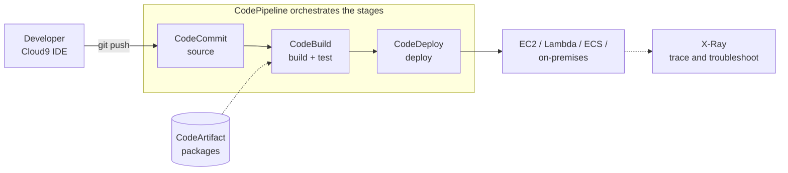

---
tags:
  - clf-c02
  - domain-3
  - task-statement
domain: 3
task: "3.8"
domain_weight: "34%"
status: not-started
aliases:
  - Task 3.8
---
# 3.8 Identify services from other in-scope AWS service categories

> [!abstract] Exam guide objective (verbatim from the CLF-C02 exam guide)
> **Knowledge of:**
> - Application integration services of Amazon EventBridge, Amazon Simple Notification Service (Amazon SNS), and Amazon Simple Queue Service (Amazon SQS)
> - Business application services of Amazon Connect and Amazon Simple Email Service (Amazon SES)
> - Customer engagement services of AWS Activate for Startups, AWS IQ, AWS Managed Services (AMS), and AWS Support
> - Developer tool services and capabilities of AWS AppConfig, AWS Cloud9, AWS CloudShell, AWS CodeArtifact, AWS CodeBuild, AWS CodeCommit, AWS CodeDeploy, AWS CodePipeline, AWS CodeStar, and AWS X-Ray
> - End-user computing services of Amazon AppStream 2.0, Amazon WorkSpaces, and Amazon WorkSpaces Web
> - Frontend web and mobile services of AWS Amplify and AWS AppSync
> - IoT services of AWS IoT Core and AWS IoT Greengrass
>
> **Skills in:**
> - Choosing the appropriate service to deliver messages and to send alerts and notifications
> - Choosing the appropriate service to meet business application needs
> - Choosing the appropriate service for AWS customer support
> - Choosing the appropriate option for business support assistance
> - Identifying the tools to develop, deploy, and troubleshoot applications
> - Identifying the services that can present the output of virtual machines (VMs) on end-user machines
> - Identifying the services that can create and deploy frontend and mobile services
> - Identifying the services that manage IoT devices

## Big picture

Task 3.8 is a sweep of seven smaller service categories. Each category has two to ten services, and the exam asks you to pick one from a short scenario. The highest-yield distinctions are: SNS (push to many) vs SQS (queue to decouple) vs EventBridge (route events by rules); Connect (contact center) vs SES (email); AMS (AWS runs your infrastructure) vs AWS IQ (hire a freelance expert) vs AWS Support (help from AWS); the Code* tools and where each sits in a CI/CD pipeline; WorkSpaces (full desktop) vs AppStream 2.0 (single apps) vs WorkSpaces Web (browser only); Amplify vs AppSync; and IoT Core (cloud) vs IoT Greengrass (edge). Several of these services have since been renamed or closed to new customers, but the exam uses the 2023 names.

## Key concepts

### Application integration: delivering messages, alerts, and notifications

Application integration services let separate parts of an application talk without being tightly connected (**decoupling**): if one part fails or slows down, the others keep working.

| | Amazon SNS | Amazon SQS | Amazon EventBridge | AWS Step Functions |
|---|---|---|---|---|
| Reference guide | "provides message delivery from publishers to subscribers" | "provides a queue to integrate and decouple distributed software systems and components" | "use events to connect application components together, build scalable event-driven applications" | "integrate with Lambda functions and view application workflows as a series of event-driven steps" |
| Model | ==Publish/subscribe, push==. One message to a **topic** goes to every subscriber (fan-out). | ==Queue, pull==. Producers add messages; consumers poll and process them at their own pace. | ==Event bus with rules==. Events from AWS services, your apps, or SaaS partners are matched by rules and routed to targets. Also runs scheduled events. | ==Workflow orchestration==. A visual state machine runs steps in order, with branching, retries, and error handling. |
| Delivers to | Email, SMS text, mobile push, HTTP/S endpoints, Lambda, SQS | Your consumer application (for example EC2 or Lambda) | Lambda, SNS, SQS, Step Functions, and many other AWS targets | Lambda and other AWS services, step by step |
| Key facts | Messages are not stored for later; subscribers get them immediately | Messages stored until processed (default 4 days, up to 14 days). Standard queues (best-effort order) and FIFO queues (exact order, exactly-once processing) | Successor to CloudWatch Events | Good for long-running, multi-step processes such as order fulfillment |
| Cue | "Send alerts/notifications to many subscribers", "SMS or email alert", "fan out" | "Decouple", "buffer requests", "process orders later", "handle spikes" | "React to events", "event-driven", "SaaS events", "schedule a task (cron)" | "Coordinate multiple Lambda functions", "workflow", "visual steps" |

Fan-out pattern: SNS topic → several SQS queues, so one event is processed independently by several systems.

### Business applications: Amazon Connect and Amazon SES

| | Amazon Connect | Amazon SES |
|---|---|---|
| Reference guide | "omnichannel cloud contact center" | "send and receive emails through existing email addresses and domains" |
| What it does | Cloud call center for voice, chat, and tasks. Agents work from a browser; pay per use, no hardware. Can use Lex bots, Polly, and Contact Lens analytics. | High-volume email: transactional (receipts, password resets), marketing, and bulk email from your own domain. Can also receive email. |
| Cue | "Customer service call center", "set up a contact center in minutes", "IVR" | "Send marketing or transactional email at scale", "email from our application" |

SNS can also send email, but only simple notification messages to subscribers of a topic. For customized, high-volume application email, the answer is SES.

### Customer engagement and business support assistance

| Option | Reference guide | Who helps you | Cue |
|---|---|---|---|
| **AWS Activate for Startups** | "provides resources to help startups build and grow on AWS" | AWS: credits, training, technical guidance, and offers for startups | "Startup", "credits", "early-stage company" |
| **AWS IQ** | "connects users to AWS Certified experts for help with AWS projects" | Third-party freelancers and AWS consulting firms you hire on demand, paid through your AWS bill | "Find a certified freelance expert for a short project" |
| **AWS Managed Services (AMS)** | "provides ongoing management for a user's AWS infrastructure" | AWS operates your infrastructure for you: patching, monitoring, backup, incident and change management, security | "Offload day-to-day operations", "AWS operates our environment", "lack in-house operations staff" |
| **AWS Support** | Support plans: Basic, Developer, Business, Enterprise On-Ramp, Enterprise | AWS Support engineers through cases; higher plans add faster responses, Trusted Advisor checks, a Technical Account Manager | "Technical help with an AWS issue", "response time", "TAM" |

"Business support assistance" questions usually ask which of these fits: ongoing operation of the whole environment (AMS), a single short project with an outside expert (AWS IQ), help for a startup (Activate), or technical support cases (AWS Support plans). Other options in [[4.3 Technical Resources and Support Options]] include AWS Professional Services, AWS Partners, and AWS re:Post. Plan details: [[Support Plans]].

Current status: AWS IQ closed to new customers in 2025 and reached end of support in May 2026.

### Developer tools: develop, deploy, and troubleshoot

| Tool | Reference guide | Role |
|---|---|---|
| **AWS CodeCommit** | "host private Git repositories, store and manage assets" | Source control |
| **AWS CodeBuild** | "compiles source code, runs unit tests, and produces artifacts that are ready to deploy" | Build and test (continuous integration) |
| **AWS CodeDeploy** | "automate application deployments to on-premises instances or select AWS resources" | Deploy to EC2, on-premises servers, Lambda, ECS |
| **AWS CodePipeline** | "model, visualize, and automate the steps to release software with continuous delivery" | Orchestrates the whole release pipeline |
| **AWS CodeArtifact** | "artifact repository that helps companies to store and share software packages for application development" | Package storage (npm, PyPI, Maven) |
| **AWS CodeStar** | "create and manage software development projects by integrating AWS services in the project development toolchain" | One-click project templates that wire the Code* tools together |
| **AWS Cloud9** | "an integrated development environment (IDE) with a built-in terminal that supports several programming languages" | Write and debug code in a browser |
| **AWS CloudShell** | "a browser-based, pre-authenticated shell that users can launch directly from the console" | Run AWS CLI commands from the console with no local setup |
| **AWS X-Ray** | "collects data about application requests and provides tools to view, filter, and gain insights into the data" | ==Troubleshoot==: trace requests through distributed apps and microservices, find bottlenecks and errors, view a service map |
| **AWS AppConfig** | "create, manage, and quickly deploy application configurations" | Change feature flags and settings safely without redeploying code, with validation and rollback (a capability of AWS Systems Manager) |

The CI/CD flow (continuous integration and continuous delivery):

Mnemonic: **Commit → Build → Deploy, Pipeline around it, X-Ray after it.**

Current status: AWS CodeStar was discontinued on July 25, 2024. AWS Cloud9 has been closed to new customers since July 25, 2024 (existing customers can still use it). AWS CodeCommit closed to new customers in July 2024 but returned to general availability in November 2025.

### End-user computing: presenting VM output on end-user machines

All three stream pixels to the user's device: the work runs on AWS, and the device shows the output. This is what "present the output of virtual machines on end-user machines" means.

| | Amazon WorkSpaces | Amazon AppStream 2.0 | Amazon WorkSpaces Web |
|---|---|---|---|
| Reference guide | "provision virtual, cloud-based desktops without the need to deploy hardware or install complex software" | "application streaming service that provides users with instant access to desktop applications from anywhere" | "facilitates secure browser access to internal websites and SaaS applications" |
| Delivers | A ==full persistent desktop== (Windows or Linux) per user: desktop as a service (DaaS) | ==Individual desktop applications== streamed to a browser; sessions usually non-persistent | A ==secure web browser== session only |
| Cue | "Virtual desktops for remote employees", "replace physical desktops", "VDI" | "Stream one application (for example a CAD tool) to users' browsers", "training labs" | "Secure access to internal web apps and SaaS without data on the device" |

Current status: Amazon WorkSpaces Web was renamed Amazon WorkSpaces Secure Browser in May 2024 and closed to new customers on October 29, 2026. Amazon AppStream 2.0 is now named Amazon WorkSpaces Applications.

### Frontend web and mobile

| | AWS Amplify | AWS AppSync | AWS Device Farm |
|---|---|---|---|
| Reference guide | "set of purpose-built tools and features to build full-stack applications" | "connect applications and services to data and events with GraphQL and pub/sub APIs" | "app testing for Android, iOS, and web apps" |
| What it does | Build, connect a backend (auth, storage, APIs), and ==host== web and mobile apps; Git-based CI/CD for frontends | Managed ==GraphQL== APIs with real-time subscriptions and offline data sync | Test apps on real phones, tablets, and browsers in the AWS Cloud |
| Cue | "Front-end developers build and deploy a full-stack web or mobile app quickly", "host a React app" | "GraphQL", "real-time data in a mobile app" | "Test on many real devices" |

### IoT: managing devices

| | AWS IoT Core | AWS IoT Greengrass |
|---|---|---|
| Reference guide | "connect and process messages between IoT devices and IoT services" | "build, deploy, and manage IoT edge runtime applications on devices" |
| Where it runs | ==In the AWS Cloud== | ==On the device or edge gateway== |
| What it does | Securely connects billions of devices (MQTT and other protocols), routes their messages with rules to other AWS services, keeps a device registry and device shadows | Runs Lambda functions, containers, and ML inference locally; keeps working without connectivity and syncs with the cloud later |
| Cue | "Connect devices to the cloud", "ingest sensor messages" | "Process data locally at the edge", "intermittent connectivity", "low latency on the device" |

## Services to know

| Service | Purpose (one line) | Question cue |
|---|---|---|
| [[Services - Application Integration#Amazon EventBridge\|Amazon EventBridge]] | Serverless event bus routing events by rules | "event-driven", "SaaS events", "schedule" |
| [[Services - Application Integration#Amazon Simple Notification Service (Amazon SNS)\|Amazon SNS]] | Pub/sub push notifications | "notify", "alert", "SMS", "fan out" |
| [[Services - Application Integration#Amazon Simple Queue Service (Amazon SQS)\|Amazon SQS]] | Message queue for decoupling | "decouple", "queue", "buffer" |
| [[Services - Application Integration#AWS Step Functions\|AWS Step Functions]] | Visual workflow orchestration | "workflow", "coordinate Lambda functions" |
| [[Services - Business Productivity#Amazon Connect\|Amazon Connect]] | Cloud contact center | "call center", "contact center" |
| [[Services - Business Productivity#Amazon Simple Email Service (Amazon SES)\|Amazon SES]] | Bulk and transactional email | "marketing email", "send email at scale" |
| [[Services - Customer Engagement#AWS Activate for Startups\|AWS Activate for Startups]] | Credits and resources for startups | "startup" |
| [[Services - Customer Engagement#AWS IQ\|AWS IQ]] | Hire AWS Certified freelance experts | "freelancer", "on-demand expert" |
| [[Services - Customer Engagement#AWS Managed Services (AMS)\|AWS Managed Services (AMS)]] | AWS operates your infrastructure | "ongoing operations", "outsource management" |
| [[Services - Customer Engagement#AWS Support\|AWS Support]] | Support plans and cases | "technical support", "response time" |
| [[Services - Developer Tools#AWS CodeCommit\|AWS CodeCommit]] | Private Git repositories | "source control", "Git" |
| [[Services - Developer Tools#AWS CodeBuild\|AWS CodeBuild]] | Compile, test, package | "build", "unit tests" |
| [[Services - Developer Tools#AWS CodeDeploy\|AWS CodeDeploy]] | Automated deployments | "deploy to EC2 and on-premises" |
| [[Services - Developer Tools#AWS CodePipeline\|AWS CodePipeline]] | CI/CD release pipeline | "continuous delivery", "automate release" |
| [[Services - Developer Tools#AWS CodeArtifact\|AWS CodeArtifact]] | Package repository | "npm, Maven, PyPI packages" |
| [[Services - Developer Tools#AWS CodeStar\|AWS CodeStar]] | Project templates for the toolchain | "quickly set up a development project" |
| [[Services - Developer Tools#AWS Cloud9\|AWS Cloud9]] | Cloud IDE | "browser-based IDE" |
| [[Services - Developer Tools#AWS CloudShell\|AWS CloudShell]] | Browser shell with CLI | "run CLI from the console" |
| [[Services - Developer Tools#AWS X-Ray\|AWS X-Ray]] | Distributed tracing | "trace requests", "debug microservices", "bottleneck" |
| [[Services - Developer Tools#AWS AppConfig\|AWS AppConfig]] | Deploy configuration and feature flags | "feature flags", "change config without redeploying" |
| [[Services - End-User Computing#Amazon WorkSpaces\|Amazon WorkSpaces]] | Virtual desktops | "virtual desktop", "VDI" |
| [[Services - End-User Computing#Amazon AppStream 2.0\|Amazon AppStream 2.0]] | Application streaming | "stream an application to a browser" |
| [[Services - End-User Computing#Amazon WorkSpaces Web\|Amazon WorkSpaces Web]] | Secure browser for internal web apps | "secure browser", "internal websites, SaaS" |
| [[Services - Frontend Web and Mobile#AWS Amplify\|AWS Amplify]] | Build and host full-stack web and mobile apps | "front-end", "full-stack", "host web app" |
| [[Services - Frontend Web and Mobile#AWS AppSync\|AWS AppSync]] | Managed GraphQL APIs | "GraphQL" |
| [[Services - Frontend Web and Mobile#AWS Device Farm\|AWS Device Farm]] | Test on real devices | "test on real phones" |
| [[Services - Internet of Things (IoT)#AWS IoT Core\|AWS IoT Core]] | Connect devices to the cloud | "connect IoT devices", "MQTT" |
| [[Services - Internet of Things (IoT)#AWS IoT Greengrass\|AWS IoT Greengrass]] | Edge runtime on devices | "run locally on devices", "edge", "offline" |

## Exam traps and commonly confused

> [!warning] SNS vs SQS
> SNS pushes one message to many subscribers right away (notifications). SQS holds messages in a queue until a consumer pulls them (decoupling, buffering). "Alert" or "notify" → SNS. "Decouple" or "queue" → SQS.

> [!warning] EventBridge vs SNS
> Both can fan out. EventBridge routes events by content-based rules and accepts events from SaaS partners and schedules. SNS is simple pub/sub to subscribers including SMS, email, and mobile push.

> [!warning] Step Functions vs SQS
> Step Functions orchestrates an ordered workflow of steps. SQS just holds messages.

> [!warning] SES vs SNS for email
> SES: customized, high-volume application or marketing email. SNS: a basic notification to a topic's email subscribers.

> [!warning] AMS vs AWS IQ vs AWS Support vs Professional Services
> AMS: AWS runs your environment day to day. AWS IQ: hire an outside certified freelancer for a project. AWS Support: technical help through support cases. AWS Professional Services: AWS consultants help with large projects such as migrations.

> [!warning] CodeBuild vs CodeDeploy vs CodePipeline
> CodeBuild compiles and tests. CodeDeploy puts the release on servers or Lambda. CodePipeline automates the whole sequence. CodeCommit stores the source code.

> [!warning] X-Ray vs CloudWatch vs CloudTrail
> X-Ray traces individual requests through an application to find where it slows or fails. CloudWatch monitors metrics, logs, and alarms. CloudTrail records API calls (who did what).

> [!warning] Cloud9 vs CloudShell
> Cloud9 is a full IDE for writing code. CloudShell is a command-line shell for running AWS CLI commands.

> [!warning] WorkSpaces vs AppStream 2.0 vs WorkSpaces Web
> Full desktop → WorkSpaces. One application streamed → AppStream 2.0. Browser access to internal websites and SaaS only → WorkSpaces Web.

> [!warning] Amplify vs AppSync vs Elastic Beanstalk
> Amplify: front-end and mobile developers build and host full-stack apps. AppSync: GraphQL API layer. Elastic Beanstalk: deploy server-side web applications onto managed EC2 environments.

> [!warning] IoT Core vs IoT Greengrass
> IoT Core is the cloud service devices connect to. Greengrass is software that runs on the devices to process data locally, even offline.

## Quick self-check

> [!question]- An application must send an SMS alert to on-call engineers when an order fails. Which service?
> Amazon SNS.

> [!question]- A web tier should place orders in a buffer so the processing tier can work through them at its own pace. Which service?
> Amazon SQS.

> [!question]- Which service routes events from SaaS applications and AWS services to targets by rules?
> Amazon EventBridge.

> [!question]- A company wants a cloud-based customer contact center. Which service?
> Amazon Connect.

> [!question]- A company with no operations staff wants AWS to handle patching, monitoring, and incident management of its infrastructure. Which option?
> AWS Managed Services (AMS).

> [!question]- Which service compiles code, runs unit tests, and produces deployable artifacts?
> AWS CodeBuild.

> [!question]- Which service helps developers trace requests through a microservices application to find the source of latency?
> AWS X-Ray.

> [!question]- Users need a full Windows desktop in the cloud that they can reach from any device. Which service?
> Amazon WorkSpaces.

> [!question]- Which service provides managed GraphQL APIs for web and mobile apps?
> AWS AppSync.

> [!question]- Factory devices must process sensor data locally when the internet link is down. Which service?
> AWS IoT Greengrass.

## AWS references

- [What is Amazon EventBridge?](https://docs.aws.amazon.com/eventbridge/latest/userguide/eb-what-is.html), [What is Amazon SNS?](https://docs.aws.amazon.com/sns/latest/dg/welcome.html), [What is Amazon SQS?](https://docs.aws.amazon.com/AWSSimpleQueueService/latest/SQSDeveloperGuide/welcome.html), [What is AWS Step Functions?](https://docs.aws.amazon.com/step-functions/latest/dg/welcome.html).
- [What is Amazon Connect?](https://docs.aws.amazon.com/connect/latest/adminguide/what-is-amazon-connect.html) and [What is Amazon SES?](https://docs.aws.amazon.com/ses/latest/dg/Welcome.html).
- [AWS Activate](https://aws.amazon.com/activate/), [What is AWS Managed Services?](https://docs.aws.amazon.com/managedservices/latest/userguide/what-is-ams.html), [AWS Support plans](https://aws.amazon.com/premiumsupport/plans/).
- [AWS CodePipeline](https://docs.aws.amazon.com/codepipeline/latest/userguide/welcome.html), [AWS CodeBuild](https://docs.aws.amazon.com/codebuild/latest/userguide/welcome.html), [AWS CodeDeploy](https://docs.aws.amazon.com/codedeploy/latest/userguide/welcome.html), [AWS CodeCommit](https://docs.aws.amazon.com/codecommit/latest/userguide/welcome.html), [AWS CodeArtifact](https://docs.aws.amazon.com/codeartifact/latest/ug/welcome.html), [AWS X-Ray](https://docs.aws.amazon.com/xray/latest/devguide/aws-xray.html), [AWS AppConfig](https://docs.aws.amazon.com/appconfig/latest/userguide/what-is-appconfig.html), [AWS CloudShell](https://docs.aws.amazon.com/cloudshell/latest/userguide/welcome.html), [AWS Cloud9](https://docs.aws.amazon.com/cloud9/latest/user-guide/welcome.html) — developer guides.
- [Amazon WorkSpaces](https://docs.aws.amazon.com/workspaces/latest/adminguide/amazon-workspaces.html), [Amazon WorkSpaces Applications (AppStream 2.0)](https://docs.aws.amazon.com/appstream2/latest/developerguide/what-is-appstream.html), [Amazon WorkSpaces Secure Browser (WorkSpaces Web)](https://docs.aws.amazon.com/workspaces-web/latest/adminguide/what-is-workspaces-secure-browser.html).
- [AWS Amplify](https://docs.aws.amazon.com/amplify/latest/userguide/welcome.html), [AWS AppSync](https://docs.aws.amazon.com/appsync/latest/devguide/what-is-appsync.html), [AWS Device Farm](https://docs.aws.amazon.com/devicefarm/latest/developerguide/welcome.html).
- [What is AWS IoT?](https://docs.aws.amazon.com/iot/latest/developerguide/what-is-aws-iot.html) and [What is AWS IoT Greengrass?](https://docs.aws.amazon.com/greengrass/v2/developerguide/what-is-iot-greengrass.html).
- Status sources: [Services in full shutdown](https://docs.aws.amazon.com/general/latest/gr/full_shutdown_services.html) (CodeStar, AWS IQ), [The future of AWS CodeCommit](https://aws.amazon.com/blogs/devops/aws-codecommit-returns-to-general-availability/), [WorkSpaces Secure Browser availability change](https://docs.aws.amazon.com/workspaces-web/latest/adminguide/workspaces-secure-browser-maintenance-mode.html).

---
Up: [[Domain 3 Overview]] · Cards: [[Flashcards - Domain 3 (Part 2)]] · Practice: [[Practice - Domain 3 (Part 2)]] · Home: [[00 - Start Here]]
