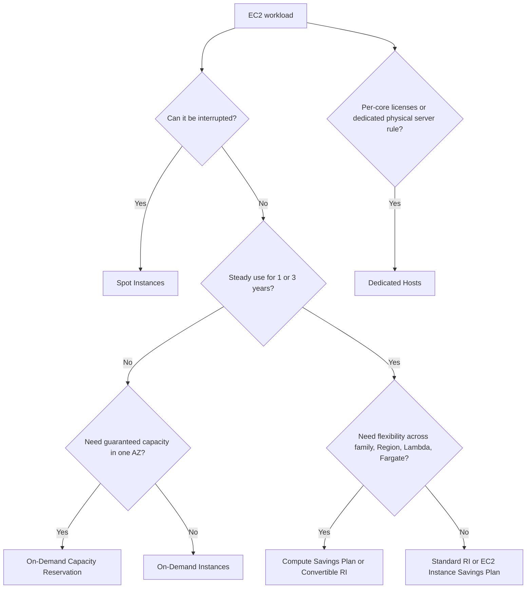

---
tags:
  - clf-c02
  - domain-4
  - task-statement
domain: 4
task: "4.1"
domain_weight: "12%"
status: not-started
aliases:
  - Task 4.1
---
# 4.1 Compare AWS pricing models

> [!abstract] Exam guide objective (verbatim from the CLF-C02 exam guide)
> **Knowledge of:**
> - Compute purchasing options (for example, On-Demand Instances, Reserved Instances, Spot Instances, Savings Plans, Dedicated Hosts, Dedicated Instances, Capacity Reservations)
> - Data transfer charges
> - Storage options and tiers
>
> **Skills in:**
> - Identifying and comparing when to use various compute purchasing options
> - Describing Reserved Instance flexibility
> - Describing Reserved Instance behavior in AWS Organizations
> - Understanding incoming data transfer costs and outgoing data transfer costs (for example, from one Region to another Region, within the same Region)
> - Understanding different pricing options for various storage options and tiers

## Big picture

AWS charges for three things above all: compute, storage, and data transfer out. This objective asks you to pick the cheapest way to pay for each one given a short workload description. Most questions are scenarios such as "a steady database running 24/7 for three years" or "a batch job that can be interrupted", and you choose the EC2 purchasing option that fits. Expect a few questions on what data transfer is free versus charged, and on how Reserved Instance and Savings Plans discounts behave across accounts in AWS Organizations. Storage questions test that each S3 storage class trades lower storage price for retrieval fees and minimum storage durations, and that EBS bills for what you provision, not what you use.

## Key concepts

### AWS pricing principles

| Principle | Meaning | Example |
| --- | --- | --- |
| **Pay as you go** | Pay only for what you use, with no upfront commitment or long-term contract. Turns capital expense into variable expense. | On-Demand EC2 billed per second; Lambda billed per request and duration. |
| **Save when you commit** | Commit to a steady amount of usage for 1 or 3 years and get a large discount. | Reserved Instances, Savings Plans. |
| **Pay less by using more** | Tiered pricing: the per-unit price drops as monthly usage grows. | S3 storage per GB gets cheaper after the first 50 TB; data transfer out per GB drops at higher volumes. |
| **Volume discounts** | Usage is combined across all accounts in an AWS Organizations organization, so the whole organization reaches cheaper tiers sooner. | Ten accounts each storing 10 TB in S3 are priced as 100 TB. |

AWS also lowers prices over time as it gains economies of scale, and the [[#AWS Free Tier]] lets new customers try services at no cost.

### EC2 purchasing options

All of these buy the same EC2 instances; only the billing model changes. ==Reserved Instances and Savings Plans are billing discounts, not separate servers.==

| Option | Commitment | Discount vs On-Demand | Best for |
| --- | --- | --- | --- |
| **On-Demand Instances** | None. Pay by the second (Linux, Windows) or hour, stop any time. | None (baseline price) | Short-term, spiky, or unpredictable workloads that cannot be interrupted; development and testing; first-time apps whose usage is unknown. |
| **Reserved Instances (RIs)** | 1-year or 3-year term for a specific instance configuration (instance type, Region or AZ, platform, tenancy) | ==Standard up to 72%==, Convertible up to 66% | Steady-state, predictable usage such as a database or a server running 24/7. |
| **Savings Plans** | 1-year or 3-year commitment to a consistent amount of compute spend in dollars per hour | ==Compute Savings Plans up to 66%; EC2 Instance Savings Plans up to 72%== | Steady usage where you want more flexibility than RIs, or usage spread across EC2, Fargate, and Lambda. |
| **Spot Instances** | None. Use spare EC2 capacity. AWS can reclaim the instance with a ==2-minute warning==. | ==Up to 90%== | Fault-tolerant, flexible, stateless, or interruptible work: batch jobs, big data, CI/CD, image rendering, test environments. |
| **Dedicated Hosts** | On-Demand (hourly) or reserved. A whole physical server for your use. | Typically the most expensive option | Server-bound software licenses (per-socket, per-core, per-VM licensing, bring your own license), and compliance rules that require a dedicated physical server and visibility of sockets and cores. |
| **Dedicated Instances** | No long-term commitment required, pay by the second (reference guide). | Premium over On-Demand | Instances that must run on hardware dedicated to a single customer, without needing control of the physical host. |
| **On-Demand Capacity Reservations** | ==No term commitment==. Reserve capacity in a specific AZ for any duration; cancel any time. | None by itself; billed at On-Demand rate whether or not instances run. Combine with Savings Plans or regional RIs for a discount. | Guaranteeing capacity for a known event, disaster recovery, or a regulatory need in one AZ. |

**Reserved Instance details**

- **Standard RI**: biggest discount. You can modify some attributes (AZ, scope, size within the same family on Linux), but you cannot change the instance family. Can be sold on the Reserved Instance Marketplace.
- **Convertible RI**: smaller discount, but can be **exchanged** for another Convertible RI with a different instance family, operating system, or tenancy, as long as the new one is of equal or greater value. Cannot be sold on the Marketplace.
- **Terms**: 1 year or 3 years. The 3-year term gives the larger discount.
- **Payment options** (same three for RIs and Savings Plans):
  - **All Upfront**: pay everything at purchase. Largest discount.
  - **Partial Upfront**: part now, the rest billed monthly over the term.
  - **No Upfront**: nothing at purchase, billed monthly over the term. Smallest discount.
- RIs exist for other services too (Amazon RDS, Amazon Redshift, Amazon ElastiCache, Amazon OpenSearch Service). Savings Plans are the newer, more flexible model for compute.

**Savings Plans: two kinds the exam knows**

| | Compute Savings Plans | EC2 Instance Savings Plans |
| --- | --- | --- |
| Max discount | Up to 66% | Up to 72% |
| Applies to | EC2 (any family, size, AZ, Region, OS, tenancy), **AWS Fargate**, and **AWS Lambda** | EC2 only, for **one instance family in one Region** |
| Flexibility | Highest: change family, Region, or move work to containers or serverless | Change size, OS, tenancy, and AZ within that family and Region |
| Reference guide wording | | "commit to a 1-year or 3-year term for individual instance families in a Region, can change instance types within the family" |

> [!tip] Choosing quickly
> Steady 24/7 and nothing will change → Standard RI or EC2 Instance Savings Plan. Steady but you expect to change instance families, Regions, or move to Lambda or Fargate → Compute Savings Plan. Steady but you may need to change family and want RIs → Convertible RI.

**Spot specifics**

- Price varies with long-term supply and demand; you pay the current Spot price.
- AWS gives a 2-minute interruption notice before reclaiming the instance.
- Never use Spot for work that cannot tolerate interruption (a production database, a payment system, a job that must finish by a deadline without restart).

**Dedicated Hosts vs Dedicated Instances**

| | Dedicated Hosts | Dedicated Instances |
| --- | --- | --- |
| What you get | An entire physical server, allocated to you | Instances on hardware dedicated to your account |
| Visibility of sockets, cores, host ID | Yes | No |
| Control instance placement on the host | Yes | No |
| Bring existing server-bound licenses (BYOL) | ==Yes, the main reason to choose it== | Not the intended use |
| Billing | Per host | Per instance |

### Workload description to purchasing option

| If the question describes… | Choose |
| --- | --- |
| A new application with unknown or unpredictable usage, no commitment possible | On-Demand Instances |
| A short project of a few weeks or months that cannot be interrupted | On-Demand Instances |
| A steady workload running all year, lowest price, configuration will not change | Standard Reserved Instances (3-year, All Upfront for the very lowest price) or EC2 Instance Savings Plan |
| A steady workload where the instance family may change during the term | Convertible Reserved Instances or Compute Savings Plan |
| Commitment that should also cover AWS Lambda and AWS Fargate | Compute Savings Plan |
| Batch processing, data analysis, or rendering that can stop and restart, cheapest option | Spot Instances |
| Software licensed per socket or per core, or a rule requiring a dedicated physical server | Dedicated Hosts |
| Must run on single-tenant hardware but no license or host-visibility need | Dedicated Instances |
| Must guarantee capacity in a specific AZ for a short event, no 1- or 3-year term | On-Demand Capacity Reservation |
| Need a reserved capacity guarantee plus a 1- or 3-year discount | Zonal Reserved Instance, or a Capacity Reservation combined with a Savings Plan |

### Reserved Instance flexibility

- **Scope: regional vs zonal.** The scope does not change the price.

| | Regional RI | Zonal RI |
| --- | --- | --- |
| Reserves capacity | ==No== | ==Yes, in the named AZ== |
| AZ flexibility | Discount applies in any AZ in the Region | Discount applies only in the named AZ |
| Instance size flexibility | Yes: discount applies to any size in the same family (Linux/Unix, default tenancy) | No: exact size only |

- **Instance size flexibility**: a regional RI for one `m5.xlarge` also covers two `m5.large` instances, because sizes within a family are normalized.
- **Modify** a Standard or Convertible RI: change AZ, scope (zonal to regional), or size within the family.
- **Exchange** (Convertible only): trade for a different family, OS, or tenancy of equal or greater value. The Region stays the same.
- **Reserved Instance Marketplace**: sell unused **Standard** RIs to other customers, or buy RIs from third parties, often with shorter remaining terms than 1 or 3 years. Convertible RIs cannot be sold there.

### Reserved Instances and Savings Plans in AWS Organizations

- With **consolidated billing**, all accounts in the organization are treated as one for discounts.
- The discount applies first to the account that bought the RI or Savings Plan. Any unused discount then ==flows automatically to matching usage in other accounts== in the organization.
- The **management account** can turn off RI and Savings Plans discount sharing for any account (in the Billing console, Billing preferences). Then that account neither shares nor receives the discount.
- Usage from all accounts is also combined for **volume pricing tiers** (for example S3 and data transfer).
- Details are in [[4.2 Billing, Budget, and Cost Management#AWS Organizations and consolidated billing|4.2 consolidated billing]].

### Data transfer charges

| Traffic | Charged? |
| --- | --- |
| Inbound from the internet into AWS | ==Free== |
| Outbound from AWS to the internet | ==Charged== per GB, tiered so the per-GB price drops at higher volume. The first 100 GB per month (all services and Regions combined) is free. |
| Between AWS Regions (for example us-east-1 to eu-west-1) | Charged (billed as outbound from the source Region) |
| Between Availability Zones in the same Region | Charged, per GB in each direction |
| Within the same AZ using private IP addresses | ==Free== |
| Within the same AZ using public or Elastic IP addresses | Charged |
| From an AWS origin (such as S3 or EC2) to Amazon CloudFront | Free; you pay CloudFront's own delivery charges |

Ways to reduce data transfer cost: keep chatty resources in the same AZ (where availability allows), use Amazon CloudFront for content delivered to users, and use AWS Direct Connect, whose outbound rates are lower than internet rates.

### Storage options, tiers, and how they are priced

**Amazon S3 pricing dimensions**: you pay for

1. **Storage**: GB per month, priced by storage class and tiered by volume.
2. **Requests and data retrievals**: per request (PUT, COPY, POST, LIST, GET), plus per-GB retrieval fees for infrequent access and archive classes.
3. **Data transfer**: out of S3 to the internet or another Region. Transfer in is free.
4. **Management and analytics features**: for example S3 Inventory, S3 Storage Lens advanced metrics, and the per-object monitoring fee in S3 Intelligent-Tiering.
5. **Replication**: storage in the destination plus transfer between Regions for cross-Region replication.

| S3 storage class | Price trade-off | Minimum storage duration | Retrieval |
| --- | --- | --- | --- |
| S3 Standard | Highest storage price, no retrieval fee | None | Milliseconds |
| S3 Intelligent-Tiering | Small monthly monitoring fee per object; moves objects between tiers automatically; no retrieval fees | None | Milliseconds (optional archive tiers are slower) |
| S3 Standard-IA | Lower storage price, per-GB retrieval fee | 30 days | Milliseconds |
| S3 One Zone-IA | Cheaper than Standard-IA, data in one AZ only | 30 days | Milliseconds |
| S3 Glacier Instant Retrieval | Archive price, retrieval fee | 90 days | Milliseconds |
| S3 Glacier Flexible Retrieval | Lower archive price | 90 days | Minutes to hours |
| S3 Glacier Deep Archive | ==Lowest storage price in AWS== | 180 days | Within 12 hours |

Deleting an object before its minimum duration still charges the remaining days. Lifecycle policies move objects to cheaper classes automatically. Full class details: [[S3 Storage Classes]].

**Amazon EBS pricing**

- You pay for the ==provisioned== size of the volume in GB per month, whether or not you fill it, until you delete it.
- Some volume types also bill for provisioned performance: gp3 includes a baseline of IOPS and throughput and charges for extra; io1 and io2 charge for provisioned IOPS.
- **Snapshots** are stored in Amazon S3 and billed per GB-month of data stored. They are incremental, so you pay only for changed blocks after the first. An archive tier for snapshots costs less for long retention.
- Volume families: SSD (gp2, gp3 general purpose; io1, io2 provisioned IOPS) and HDD (st1 throughput optimized, sc1 cold, the cheapest).
- **Instance store** has no separate charge; it is included in the instance price, but data is lost when the instance stops.

**Other storage at a glance**: Amazon EFS bills for storage used (not provisioned) with Standard, Infrequent Access, and Archive classes; Amazon FSx bills for provisioned capacity; AWS Backup bills for backup storage. See [[Storage Picker]].

### AWS Free Tier

The exam knows three types of Free Tier offers:

| Type | Meaning | Example |
| --- | --- | --- |
| **Always Free** | Never expires, for new and existing customers, within monthly limits | AWS Lambda 1 million requests per month; Amazon DynamoDB 25 GB of storage |
| **12 Months Free** | Free for 12 months after sign-up, within monthly limits | 750 hours per month of a small EC2 instance; 5 GB of S3 Standard; 750 hours per month of a small RDS instance |
| **Trials** | Short-term free trials that start when you first activate the service | Trials of services such as Amazon SageMaker or Amazon Redshift |

Free Tier use above the limits is billed at normal rates. AWS Budgets has a Free Tier usage alert, and the Billing console shows Free Tier usage.

Current status: for accounts opened on or after July 15, 2025, AWS replaced the 12 Months Free offers with up to $200 in Free Tier credits ($100 at sign-up plus up to $100 earned by trying services) and a choice of a free plan (ends after 6 months or when credits run out) or a paid plan. Always Free offers continue. Accounts opened before July 15, 2025 keep the older 12-month offers. Learn the three types above for the exam.

## Services to know

| Service | Purpose | Question cue |
| --- | --- | --- |
| [[Services - Compute#Amazon EC2\|Amazon EC2]] | Virtual servers, bought through the purchasing options above | "instance", "pay by the second", "interruptible", "1-year or 3-year" |
| [[Services - Serverless#AWS Lambda\|AWS Lambda]] | Serverless functions, pay per request and duration | "covered by a Compute Savings Plan" |
| [[Services - Serverless#AWS Fargate\|AWS Fargate]] | Serverless containers | "covered by a Compute Savings Plan" |
| [[Services - Storage#Amazon S3\|Amazon S3]] | Object storage priced per GB-month, requests, retrieval, transfer out | "storage class", "infrequently accessed", "minimum storage duration" |
| [[Services - Storage#Amazon S3 Glacier\|Amazon S3 Glacier]] | Archive storage classes | "archive", "retrieve in hours", "lowest cost storage" |
| [[Services - Storage#Amazon Elastic Block Store (Amazon EBS)\|Amazon EBS]] | Block storage billed by provisioned GB | "pay for provisioned size", "snapshots" |
| [[Services - Networking and Content Delivery#Amazon CloudFront\|Amazon CloudFront]] | CDN; reduces data transfer out cost and latency | "reduce data transfer costs for global users" |
| [[Services - Management and Governance#AWS Organizations\|AWS Organizations]] | Consolidated billing, shared RI and Savings Plans discounts, volume tiers | "share Reserved Instance discounts across accounts" |
| [[Services - Cost Management#AWS Cost Explorer\|AWS Cost Explorer]] | Shows RI and Savings Plans purchase recommendations and utilization | "recommend how many Reserved Instances to buy" |
| [[Services - Management and Governance#AWS Compute Optimizer\|AWS Compute Optimizer]] | Rightsizing recommendations | "over-provisioned instances" |

## Exam traps and commonly confused

> [!warning] Dedicated Hosts vs Dedicated Instances
> Both are single-tenant. Only **Dedicated Hosts** give you the physical server, visibility of sockets and cores, and support for server-bound licenses (BYOL). "Licensing" in the question means Dedicated Hosts.

> [!warning] Capacity Reservation vs Reserved Instance
> An **On-Demand Capacity Reservation** guarantees capacity with **no term** and gives **no discount**. A **Reserved Instance** is a 1- or 3-year **discount**; only a **zonal** RI also reserves capacity. A **regional** RI does not reserve capacity.

> [!warning] Spot vs Reserved for "cheapest"
> Spot is the cheapest (up to 90%) but only if the work can be interrupted. For a steady production workload that must not stop, the cheapest correct answer is Reserved Instances or Savings Plans.

> [!warning] Compute Savings Plans vs EC2 Instance Savings Plans
> Only **Compute** Savings Plans cover Lambda and Fargate and let you change Region. **EC2 Instance** Savings Plans lock you to one instance family in one Region but give the bigger discount (72% vs 66%).

> [!warning] Standard vs Convertible RI
> Standard: bigger discount, can be sold on the RI Marketplace, cannot change family. Convertible: smaller discount, can be exchanged for a different family, OS, or tenancy, cannot be sold.

> [!warning] Data transfer direction
> Data **in** from the internet is free; data **out** to the internet is charged. Between AZs is charged even inside one Region. Only same-AZ traffic over **private** IPs is free.

> [!warning] EBS vs S3 billing
> EBS bills the **provisioned** volume size; S3 and EFS bill the data actually **stored**.

## Quick self-check

> [!question]- A rendering job can be stopped and restarted at any time. What is the lowest-cost EC2 option?
> Spot Instances, up to 90% off On-Demand.

> [!question]- A company must use its existing per-core database license on EC2. Which option?
> Dedicated Hosts.

> [!question]- Which Savings Plan type covers EC2, AWS Fargate, and AWS Lambda?
> Compute Savings Plans (up to 66% off).

> [!question]- Which RI scope reserves capacity in a specific Availability Zone?
> A zonal Reserved Instance. A regional RI gives AZ and instance size flexibility but no capacity reservation.

> [!question]- Which RI type can be exchanged for a different instance family?
> Convertible Reserved Instances.

> [!question]- Where can you sell unused Standard Reserved Instances?
> The Reserved Instance Marketplace.

> [!question]- An organization has one account with an unused RI and another account running a matching instance On-Demand. What happens on the consolidated bill?
> The RI discount is applied to the other account's matching usage automatically, unless the management account has turned off RI sharing.

> [!question]- Which data transfer is free: internet to EC2, EC2 to internet, between two AZs, or between two Regions?
> Internet to EC2 (inbound). The other three are charged.

> [!question]- A team needs guaranteed EC2 capacity in one AZ for a two-week event and cannot commit to a year. Which option?
> On-Demand Capacity Reservation.

> [!question]- Name three things S3 charges for besides storage.
> Requests and data retrievals, data transfer out, and management features (also replication).

## AWS references

- [How AWS Pricing Works whitepaper](https://docs.aws.amazon.com/whitepapers/latest/how-aws-pricing-works/welcome.html): pricing principles and per-service pricing basics.
- [AWS Pricing](https://aws.amazon.com/pricing/): pricing overview page.
- [Amazon EC2 pricing](https://aws.amazon.com/ec2/pricing/): all purchasing options.
- [EC2 Reserved Instances pricing](https://aws.amazon.com/ec2/pricing/reserved-instances/): Standard vs Convertible, payment options.
- [Savings Plans](https://aws.amazon.com/savingsplans/) and [Savings Plans FAQ](https://aws.amazon.com/savingsplans/faq/): Compute vs EC2 Instance Savings Plans.
- [Amazon EC2 Spot Instances](https://aws.amazon.com/ec2/spot/): Spot overview.
- [Amazon EC2 Dedicated Hosts](https://aws.amazon.com/ec2/dedicated-hosts/): licensing and dedicated servers.
- [On-Demand Capacity Reservations](https://docs.aws.amazon.com/AWSEC2/latest/UserGuide/ec2-capacity-reservations.html): user guide.
- [Regional and zonal Reserved Instances](https://docs.aws.amazon.com/AWSEC2/latest/UserGuide/reserved-instances-scope.html): RI scope and size flexibility.
- [Exchange Convertible Reserved Instances](https://docs.aws.amazon.com/AWSEC2/latest/UserGuide/ri-convertible-exchange.html): exchange rules.
- [Sell in the Reserved Instance Marketplace](https://docs.aws.amazon.com/AWSEC2/latest/UserGuide/ri-market-general.html): Marketplace rules.
- [RI and Savings Plans discount sharing](https://docs.aws.amazon.com/awsaccountbilling/latest/aboutv2/ri-turn-off.html): sharing across an organization.
- [Amazon S3 pricing](https://aws.amazon.com/s3/pricing/) and [Amazon EBS pricing](https://aws.amazon.com/ebs/pricing/): storage pricing dimensions.
- [AWS Free Tier](https://aws.amazon.com/free/), [Free Tier FAQs](https://aws.amazon.com/free/free-tier-faqs/), and [Free Tier terms](https://aws.amazon.com/free/terms/): current Free Tier program.

---
Up: [[Domain 4 Overview]] · Cards: [[Flashcards - Domain 4]] · Practice: [[Practice - Domain 4]] · Home: [[00 - Start Here]]
