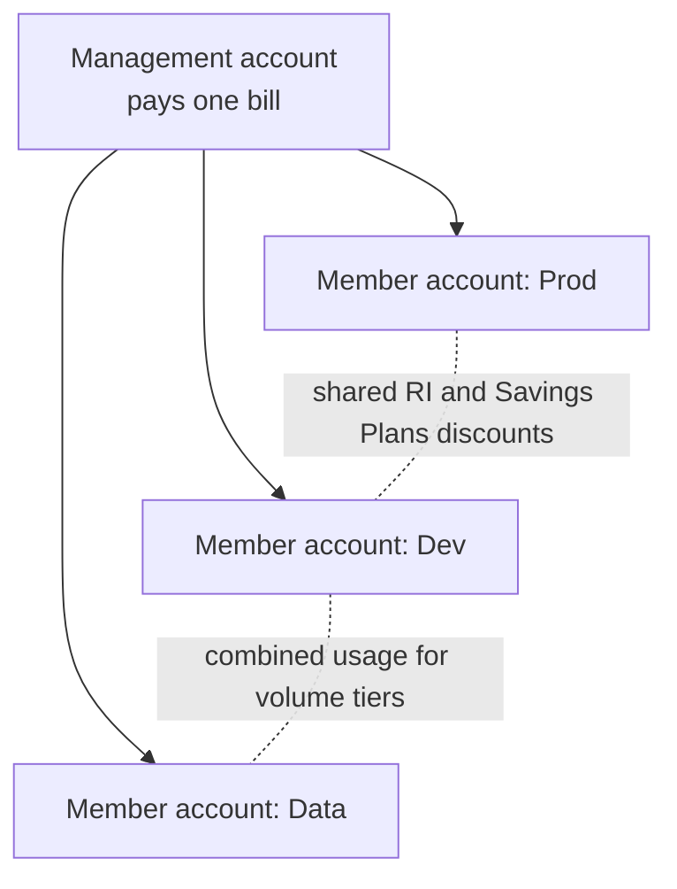

---
tags:
  - clf-c02
  - domain-4
  - task-statement
domain: 4
task: "4.2"
domain_weight: "12%"
status: not-started
aliases:
  - Task 4.2
---
# 4.2 Understand resources for billing, budget, and cost management

> [!abstract] Exam guide objective (verbatim from the CLF-C02 exam guide)
> **Knowledge of:**
> - Billing support and information
> - Pricing information for AWS services
> - AWS Organizations
> - AWS cost allocation tags
>
> **Skills in:**
> - Understanding the appropriate uses and capabilities of AWS Budgets, AWS Cost Explorer, and AWS Billing Conductor
> - Understanding the appropriate uses and capabilities of AWS Pricing Calculator
> - Understanding AWS Organizations consolidated billing and allocation of costs
> - Understanding various types of cost allocation tags and their relation to billing reports (for example, AWS Cost and Usage Report)

## Big picture

AWS gives you a family of cost tools, and the exam mostly asks you to match a need to the right one. The key split is time: the AWS Pricing Calculator **estimates before** you build, AWS Budgets **alerts during** the month against a threshold, AWS Cost Explorer **analyzes after** the fact with charts and a forecast, and the AWS Cost and Usage Report is the **most detailed raw data**. AWS Billing Conductor is the odd one out: it creates custom (pro forma) bills for showback and chargeback. The objective also covers AWS Organizations consolidated billing (one bill, combined volume discounts, shared Reserved Instance and Savings Plans discounts) and cost allocation tags, which must be activated before they show up in billing reports.

## Key concepts

### The cost tools at a glance

| Tool | When | What it does | Cue in a question |
| --- | --- | --- | --- |
| **AWS Pricing Calculator** | Before you deploy | Estimates the monthly cost of an architecture you have not built yet. Free, no AWS account needed, estimates can be saved, shared by link, and exported. | "estimate", "before migrating", "compare cost of a planned solution" |
| **AWS Budgets** | During the month, proactive | Sets a custom cost or usage threshold and alerts (email or Amazon SNS) when **actual** or **forecasted** spend crosses it. Can run budget actions. | "alert when spend exceeds", "notify when forecast", "threshold" |
| **AWS Cost Explorer** | After the fact, analysis | Visualizes cost and usage with charts, filters, and grouping. Reference guide: "past 12 months and a forecast of the next 12 months". RI and Savings Plans recommendations. | "visualize", "trends", "which service cost the most", "forecast", "graph" |
| **AWS Cost and Usage Report (CUR)** | After the fact, raw detail | ==The most comprehensive set of cost and usage data==: line items by hour, day, or month, delivered to an Amazon S3 bucket; query with Amazon Athena, or load into Amazon Redshift or Amazon QuickSight. | "most detailed", "line item", "hourly", "deliver to S3", "query with Athena" |
| **AWS Billing Conductor** | Custom billing | Creates pro forma bills with your own pricing rules and account groupings, for **showback and chargeback**. Does not change what you pay AWS. | "reseller", "AWS Solution Provider", "chargeback with custom rates", "showback" |
| **AWS Cost Anomaly Detection** | Continuous | Uses machine learning to spot unusual spend and alerts you with root-cause details. | "unexpected spike", "anomaly", "machine learning to detect unusual spend" |
| **AWS Billing and Cost Management console** | Any time | Home of bills, invoices, payments, credits, tax settings, Free Tier usage, cost allocation tags, Cost Categories, and billing preferences. | "view the bill", "download invoice", "update payment method" |

### AWS Pricing Calculator

- Builds a cost estimate for a planned workload by configuring services (instance types, storage, data transfer).
- Lets you compare options, such as On-Demand vs Reserved, before committing.
- Does not need an AWS account and has no charge. Estimates can be shared through a link and exported to CSV or PDF.
- Use it for "how much will this cost?" Use Cost Explorer for "how much did this cost?"

### AWS Budgets

- Reference guide: "set a monthly cost budget with alerts for actual spend or forecasted spend".
- Budget types: **cost** budgets, **usage** budgets, **Reserved Instance utilization or coverage** budgets, and **Savings Plans utilization or coverage** budgets.
- Periods: daily, monthly, quarterly, or yearly.
- Alerts go to email addresses or an Amazon SNS topic (and from SNS to chat tools).
- **Budget actions** can respond automatically: apply an IAM policy or a service control policy (SCP), or stop specific EC2 or RDS instances.
- AWS Budgets also offers a Free Tier usage alert so you know before you leave the Free Tier.

### AWS Cost Explorer

- Graphs costs by service, linked account, Region, usage type, tag, or Cost Category; daily or monthly (hourly can be enabled).
- Reference guide: past 12 months of data and a forecast of the next 12 months.
- Shows **Reserved Instance and Savings Plans recommendations, utilization, and coverage** reports, and rightsizing recommendations for EC2.
- Filters by cost allocation tags only after the tags are activated.

### AWS Cost and Usage Report (CUR)

- Reference guide: "contains the most comprehensive set of cost and usage data available".
- Delivered as CSV files (or Parquet) to an S3 bucket you own, updated at least once a day.
- Granularity: hourly, daily, or monthly, by product, resource, and tag.
- Activated cost allocation tags appear as **extra columns**, so you can sum costs by cost center, project, or owner.
- Analyze with Amazon Athena (SQL directly on S3), Amazon Redshift, or Amazon QuickSight.

Current status: AWS now delivers the report through AWS Data Exports, which offers CUR 2.0 (a fixed schema with SQL column selection) alongside the legacy CUR. AWS says it has no plans to retire the legacy CUR. The exam name is still AWS Cost and Usage Report.

### AWS Billing Conductor

- Reference guide: "custom billing service that can support showback and chargeback workflows of AWS Solution Providers and Enterprise customers".
- You group accounts into **billing groups** and apply **pricing rules** (markups, discounts, custom line items such as a support fee) to produce **pro forma** cost data.
- **Showback** shows each team what it cost; **chargeback** actually bills the team. Both need custom rates when a reseller or central IT does not pass on the exact AWS rate.
- Your real AWS invoice does not change.

### AWS Cost Anomaly Detection (mention level)

A free feature of AWS Cost Management that uses machine learning to monitor spend, detects anomalies, and sends alerts by email or SNS with the likely root cause (service, account, Region, usage type).

### Billing support and information

- **AWS Billing and Cost Management console**: view and pay bills, download invoices, set payment methods, view credits and Free Tier usage, set billing preferences (PDF invoices by email, Free Tier alerts), manage cost allocation tags and Cost Categories.
- **Billing alarms**: an Amazon CloudWatch alarm on the `EstimatedCharges` metric. You first turn on billing alerts in Billing preferences; the metric lives in the us-east-1 (N. Virginia) Region.
- **Account and billing support cases** are free for every customer, including the Basic Support plan, through the AWS Support Center.
- The **Concierge** team (Enterprise On-Ramp and Enterprise Support) is the billing and account specialist team. See [[4.3 Technical Resources and Support Options]].

### Pricing information for AWS services

- **Service pricing pages** on aws.amazon.com (for example the EC2 and S3 pricing pages) show public rates by Region.
- **AWS Pricing Calculator** for estimates of a planned architecture.
- **AWS Price List API** for programmatic access to current prices.
- Prices differ by Region, so always check the Region you plan to use.

### AWS Organizations and consolidated billing

- **AWS Organizations** groups many AWS accounts. The **management account** (formerly payer account) creates the organization and pays the bills of all **member accounts** (linked accounts).
- **Consolidated billing** benefits (AWS documentation):
  - **One bill** for all accounts.
  - **Easy tracking** of charges across accounts, with per-account cost reports.
  - **Combined usage**: usage across all accounts adds up for ==volume pricing tiers==, and ==Reserved Instance and Savings Plans discounts are shared==.
  - **No extra fee** for consolidated billing.
- **Allocation of costs**: the management account sees charges per member account in Cost Explorer, the CUR, and the bill. Separate accounts per team, project, or environment is the simplest way to allocate costs. Cost allocation tags and Cost Categories allocate within or across accounts.
- RI and Savings Plans discounts apply first to the purchasing account, then to other accounts. The management account can turn sharing off per account.
- Organizations is also a governance tool (service control policies). That side is covered in [[Services - Management and Governance#AWS Organizations|AWS Organizations]].

### Cost allocation tags

A **tag** is a key-value label on a resource (for example `CostCenter = 1234`). A **cost allocation tag** is a tag you have activated so AWS uses it to organize costs in billing reports.

| | AWS-generated tags | User-defined tags |
| --- | --- | --- |
| Who creates and applies them | AWS (or an AWS Marketplace vendor) | You |
| Prefix in reports | `aws:` (for example `aws:createdBy`) | `user:` |
| Must be activated | Yes | Yes |

- ==Both types must be **activated** in the Billing and Cost Management console before they appear in Cost Explorer or the cost allocation and Cost and Usage Reports.==
- Only the **management account** (or a standalone account) can activate cost allocation tags.
- After activation, tags can take up to 24 hours to appear. They apply to costs from activation forward; AWS supports a backfill request for earlier months.
- Activated tags appear as columns in the **AWS Cost and Usage Report** and as filter and group-by options in **AWS Cost Explorer**. AWS Budgets can also be scoped by tag.
- Untagged resources still appear in reports, so totals always match the bill.
- Apply tags in bulk with **AWS Resource Groups and Tag Editor**; enforce tagging with tag policies in AWS Organizations.

## Services to know

| Service | Purpose | Question cue |
| --- | --- | --- |
| [[Services - Cost Management#AWS Pricing Calculator\|AWS Pricing Calculator]] | Estimate cost before deploying | "estimate", "planned architecture" |
| [[Services - Cost Management#AWS Budgets\|AWS Budgets]] | Threshold alerts on actual or forecasted cost or usage | "alert", "notify when", "budget" |
| [[Services - Cost Management#AWS Cost Explorer\|AWS Cost Explorer]] | Visualize and forecast spend; RI and Savings Plans recommendations | "visualize", "trend", "forecast", "graph" |
| [[Services - Cost Management#AWS Cost and Usage Report\|AWS Cost and Usage Report]] | Most detailed line-item data to S3 | "most comprehensive", "hourly line items", "Athena" |
| [[Services - Cost Management#AWS Billing Conductor\|AWS Billing Conductor]] | Pro forma custom-rate bills for showback and chargeback | "reseller", "custom rates", "chargeback" |
| [[Services - Management and Governance#AWS Organizations\|AWS Organizations]] | Consolidated billing, one bill, shared discounts | "single bill", "multiple accounts", "volume discount" |
| [[Services - Management and Governance#AWS Resource Groups and Tag Editor\|AWS Resource Groups and Tag Editor]] | Apply and manage tags in bulk | "tag many resources at once" |
| [[Services - Management and Governance#Amazon CloudWatch\|Amazon CloudWatch]] | Billing alarm on estimated charges | "billing alarm" |
| [[Services - Cost Management#AWS Marketplace\|AWS Marketplace]] | Third-party software billed on the AWS bill | "third-party license on the AWS invoice" |

## Exam traps and commonly confused

| Look-alikes | Distinguishing fact |
| --- | --- |
| AWS Budgets vs AWS Cost Explorer | Budgets **alerts** on a threshold you set (proactive). Cost Explorer **analyzes and visualizes** past spend and forecasts (reactive). "Notify" means Budgets. |
| AWS Cost Explorer vs Cost and Usage Report | Cost Explorer is a visual console tool. CUR is the **most detailed** raw file delivered to S3 for your own analysis. |
| AWS Pricing Calculator vs Cost Explorer | Calculator **estimates future** cost of something not yet built. Cost Explorer shows **actual** cost of what is running. |
| AWS Billing Conductor vs Organizations consolidated billing | Consolidated billing produces the **real** single bill. Billing Conductor produces **pro forma** bills with **custom rates** for showback and chargeback. |
| Cost allocation tags vs tags in general | A tag does nothing for billing until it is **activated** as a cost allocation tag in the Billing console. |
| AWS-generated vs user-defined tags | AWS-generated use the `aws:` prefix and AWS applies them; user-defined use `user:` and you apply them. **Both** need activation. |
| AWS Budgets vs Cost Anomaly Detection | Budgets compares to a fixed threshold you choose. Anomaly Detection uses machine learning to find unusual patterns without a fixed threshold. |
| AWS Budgets vs CloudWatch billing alarm | Both can alert on spend. Budgets supports forecasts, usage, RI and Savings Plans budgets, and actions; a CloudWatch billing alarm watches only estimated charges. Budgets is the usual exam answer. |
| Trusted Advisor vs Cost Explorer | Trusted Advisor's cost optimization checks find idle or underused resources. Cost Explorer analyzes spend and recommends RI and Savings Plans purchases. |

> [!warning] Member accounts and tags
> Only the **management account** activates cost allocation tags and sees the organization-wide view. Member accounts see only their own costs.

## Quick self-check

> [!question]- A company wants an email when forecasted monthly spend will exceed $5,000. Which tool?
> AWS Budgets.

> [!question]- A finance team wants to see a chart of the last six months of spend grouped by service. Which tool?
> AWS Cost Explorer.

> [!question]- Which source has the most detailed, hourly, line-item cost data and is delivered to S3?
> AWS Cost and Usage Report.

> [!question]- A reseller needs to bill its customers using its own custom rates on top of AWS usage. Which service?
> AWS Billing Conductor.

> [!question]- A team must estimate the monthly cost of an architecture before migrating. Which tool?
> AWS Pricing Calculator.

> [!question]- Name the four benefits of consolidated billing.
> One bill, easy tracking across accounts, combined usage for volume pricing and shared RI and Savings Plans discounts, and no extra fee.

> [!question]- A user tagged resources with `Project=Atlas`, but the tag does not appear in Cost Explorer. Why?
> The tag has not been activated as a cost allocation tag in the Billing and Cost Management console (by the management account), or it was activated less than 24 hours ago.

> [!question]- What prefix do AWS-generated cost allocation tags use?
> `aws:` (user-defined tags appear with `user:`).

> [!question]- Which AWS Budgets types exist besides cost budgets?
> Usage budgets, RI utilization and coverage budgets, and Savings Plans utilization and coverage budgets.

## AWS references

- [What is AWS Billing and Cost Management?](https://docs.aws.amazon.com/awsaccountbilling/latest/aboutv2/billing-what-is.html): the billing console and features.
- [AWS Pricing Calculator](https://aws.amazon.com/aws-cost-management/aws-pricing-calculator/) and its [user guide](https://docs.aws.amazon.com/pricing-calculator/latest/userguide/what-is-pricing-calculator.html).
- [Managing costs with AWS Budgets](https://docs.aws.amazon.com/cost-management/latest/userguide/budgets-managing-costs.html): budget types and alerts.
- [Analyzing costs with AWS Cost Explorer](https://docs.aws.amazon.com/cost-management/latest/userguide/ce-what-is.html): Cost Explorer user guide.
- [What are AWS Cost and Usage Reports?](https://docs.aws.amazon.com/cur/latest/userguide/what-is-cur.html): CUR user guide.
- [What is AWS Billing Conductor?](https://docs.aws.amazon.com/billingconductor/latest/userguide/what-is-billingconductor.html): pro forma billing.
- [AWS Cost Anomaly Detection](https://docs.aws.amazon.com/cost-management/latest/userguide/manage-ad.html): anomaly monitors and alerts.
- [Consolidated billing for AWS Organizations](https://docs.aws.amazon.com/awsaccountbilling/latest/aboutv2/consolidated-billing.html): benefits and behavior.
- [RI and Savings Plans discount sharing](https://docs.aws.amazon.com/awsaccountbilling/latest/aboutv2/ri-turn-off.html): turning sharing on or off.
- [AWS cost allocation tags](https://docs.aws.amazon.com/awsaccountbilling/latest/aboutv2/cost-alloc-tags.html): AWS-generated vs user-defined, activation.
- [AWS Pricing](https://aws.amazon.com/pricing/): service pricing pages.

---
Up: [[Domain 4 Overview]] · Cards: [[Flashcards - Domain 4]] · Practice: [[Practice - Domain 4]] · Home: [[00 - Start Here]]
